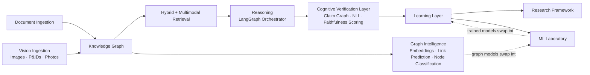

# IKIOS — Industrial Knowledge Intelligence OS


**Not a chatbot. Not "chat with PDF."** IKIOS is a nine-layer industrial AI
platform: it ingests heterogeneous documents *and images* (P&IDs, inspection
photos, engineering drawings), builds a persistent knowledge graph spanning
text and vision, learns graph embeddings from that graph, reasons over
evidence with explicit contradiction detection, generates justified
recommendations, learns from feedback, trains real machine learning models,
and exposes a full research/benchmarking framework — chat is the surface,
not the architecture.

Built for the **ET AI Hackathon 2026** — Problem Statement 8: *"AI for
Industrial Knowledge Intelligence: Unified Asset & Operations Brain."*

## Problem statement

Industrial organizations accumulate maintenance logs, inspection reports,
incident reports, OEM manuals, SOPs, and compliance records across years of
operation — scattered, unstructured, and effectively unsearchable at the
moment an engineer needs to answer "why does this pump keep failing, and what
should I do about it?" IKIOS turns that document pile into a queryable,
reasoning knowledge system that cites its sources, flags when sources
disagree, and predicts what's likely to happen next.

## Why this is more than RAG

| Layer | What it does |
| --- | --- |
| Document Ingestion | Chunking, embeddings, entity/relation extraction |
| Knowledge Graph | 24-label ontology, 15 relation types, persistent graph |
| Hybrid Retrieval | BM25 + vector + graph expansion + cross-encoder reranking |
| Agentic Reasoning | 13-stage LangGraph pipeline: plan → retrieve → fuse evidence → reason → extract/verify/propagate claims → recommend → verify → narrate → score faithfulness |
| Learning Layer | Timeline reconstruction, rule-based prediction, feedback loop |
| Research Framework | Real benchmarks, reproducible experiments, A/B testing |
| ML Laboratory | Real scikit-learn training, model registry, explainability, drift monitoring |
| Multimodal Vision | OCR, diagram parsing, equipment/gauge/defect detection — images become graph evidence too |
| Graph Intelligence | Node2Vec/DeepWalk/GCN/GraphSAGE/GAT embeddings, link prediction, node classification, risk propagation — another reasoning source, not a replacement for symbolic reasoning |
| Retrieval Optimization | Learning-to-rank, parallel fetch, multi-level caching, entity resolution, context compression, retrieval explainability — all optional layers behind the existing Hybrid Retrieval interface |
| Faithful Cognitive Reasoning | Structured Claim Graph, claim verification against the Knowledge Graph, NLI, confidence propagation, recommendation verification, and per-answer faithfulness scoring — the LLM narrates from verified claims only, never raw retrieved text |

Every claim in a Chat answer traces back to a cited document chunk.
Contradictions across sources are surfaced explicitly, never silently
resolved. See [docs/architecture/README.md](docs/architecture/README.md) for
the full picture with diagrams.

## Architecture



Full diagrams for every subsystem: [docs/architecture/](docs/architecture/README.md).

## Showcase

Real captured output (not mockups) from all six workspaces (Chat,
Documents, Research, ML Lab, Vision, Graph Intelligence) against the real running app and the
[demo dataset](demo_data/README.md) is in
[docs/showcase/README.md](docs/showcase/README.md) — text/JSON/accessibility-tree
excerpts rather than image screenshots, for reasons explained there.

## Technology stack

**Backend:** Python 3.13, FastAPI, LangGraph, SQLAlchemy (async), scikit-learn,
pandas, Neo4j driver, Qdrant client, GLiNER, sentence-transformers,
OpenCV (classical CV vision baseline), EasyOCR, Pillow.
**Frontend:** React 19, TypeScript, Vite, Tailwind CSS, Recharts.
**Infra:** Docker Compose (Qdrant + Neo4j), SQLite (metadata/learning/
experiment/ML-registry stores).

## Installation

```bash
git clone https://github.com/NisirBage/industrial-knowledge-os.git
cd industrial-knowledge-os
./setup.sh      # or .\setup.ps1 on Windows
./run-dev.sh    # or .\run-dev.ps1 — starts backend (:8000) + frontend (:5173)
```

No Docker, no API key, and no downloaded ML model are required — every
optional dependency falls back automatically (see
[docs/architecture/deployment.md](docs/architecture/deployment.md)). Full
walkthrough: [docs/getting-started/installation.md](docs/getting-started/installation.md).

## Quick start

```bash
cd backend && python scripts/seed_demo_data.py
```

Then open http://localhost:5173 and ask: *"What is the failure history of
P-101?"* — see [docs/getting-started/quickstart.md](docs/getting-started/quickstart.md)
for the full four-workspace tour.

## Usage

- **Chat** — ask a question, get a cited, evidence-backed, reasoned answer
- **Documents** — upload PDF/TXT/MD, see it ingested (chunks, entities, relations) in real time
- **Research** — run benchmarks and A/B tests on demand, view experiment history
- **ML Lab** — train a real scikit-learn model, view its ROC/calibration/confusion matrix, browse the model registry
- **Vision** — upload an image, watch it get analyzed (OCR, diagram parsing, equipment detection, gauge reading, defect detection), explore results as overlays on the image, browse the Knowledge Graph entities created, and ask multimodal questions — see [docs/architecture/vision.md](docs/architecture/vision.md)
- **Graph Intelligence** — explore the Knowledge Graph interactively, train embeddings, run link prediction and node classification, simulate risk propagation
- **Executions** — browse every chat turn's `ExecutionTrace` (search/sort/filter), inspect a Pipeline Waterfall, confidence evolution, and Execution DAG for any execution
- **Failure Intelligence** — mine recurring failure patterns, explore a Root Cause Graph, run counterfactual "what if this subsystem were disabled" simulations, and review evidence-backed optimization recommendations — see [docs/architecture/execution-intelligence.md](docs/architecture/execution-intelligence.md)

Full API reference: [docs/api/README.md](docs/api/README.md).

## Benchmarks

Real, reproducible benchmark reports (not hand-typed numbers) live in
[docs/benchmarks/README.md](docs/benchmarks/README.md), generated by
`backend/scripts/generate_benchmark_reports.py`. Covers entity/relation
extraction, knowledge graph coverage, hybrid retrieval, reasoning,
recommendations, predictions, timelines, plus dedicated comparisons: regex
vs. GLiNER, vector-only vs. hybrid vs. graph-aware retrieval, and rule-based
vs. ML prediction — including honest caveats where a result needs one (e.g.
GLiNER's availability in a given environment).

## ML Laboratory

Seven subsystems — Training Dataset Builder, Feature Store, Model Training
Framework, Model Registry, Inference Engine, Explainability, Model
Monitoring — turning rule-based prediction into real, trained, explainable
machine learning without ever touching the reasoning pipeline. Details:
[docs/architecture/ml-lab.md](docs/architecture/ml-lab.md).

## Research Framework

Experiment tracking (with git-commit auto-capture), 8 benchmark runners
against the real production components, a synthetic dataset generator with
noise injection, paired A/B testing, and JSON/CSV/Markdown/HTML report
export. Details: [docs/architecture/research.md](docs/architecture/research.md).

## Folder structure

```
industrial-knowledge-os/
├── backend/            # FastAPI app, all business logic, 444 tests
│   ├── app/             # see docs/architecture/backend.md for the full map
│   ├── tests/
│   └── scripts/         # seed_demo_data.py, generate_benchmark_reports.py
├── frontend/            # React + Vite, 5 workspaces, 66 tests (Vitest + RTL)
├── demo_data/           # curated demo dataset + ground truth
├── docs/                # documentation portal (this is the map)
├── docker-compose.yml   # Qdrant + Neo4j (optional — see fallback modes)
├── setup.{sh,ps1}, run-dev.{sh,ps1}, run-prod.{sh,ps1}
└── CHANGELOG.md, RELEASE_NOTES.md, VERSION
```

## API overview

Base URL `http://localhost:8000/api/v1`, interactive docs at `/docs`. Full
reference: [docs/api/README.md](docs/api/README.md). Highlights:

| Endpoint | Purpose |
| --- | --- |
| `POST /chat` | Reasoned, cited answer via the 8-stage pipeline |
| `POST /documents/upload` | Full ingestion pipeline |
| `GET /equipment/{tag}/timeline` | Reconstructed event history |
| `POST /predictions` | Rule-based or trained-ML prediction |
| `POST /research/benchmarks/{name}/run` | Run a benchmark now |
| `POST /ml/train/{task}` | Train a real scikit-learn model, hot-swap it live |
| `POST /vision/images/{id}/analyze` | OCR + diagram + detection + gauge + defect analysis, written into the graph |
| `POST /vision/query` | Multimodal (text + visual) evidence retrieval |

## Testing

```bash
cd backend
pip install -r requirements-dev.txt
pytest -q                                       # 444 tests
pytest -q --cov=app --cov-report=term-missing   # with coverage (96%)

cd ../frontend
npm test                                        # 107 tests (Vitest + React Testing Library)
```

Every milestone's test suite has been a strict superset of the previous
one's — nothing has ever been weakened or deleted to make a later milestone
pass. 659 tests total. See [docs/contributing/testing.md](docs/contributing/testing.md).

## Performance

Benchmarked latencies and retrieval/prediction accuracy are in
[docs/benchmarks/README.md](docs/benchmarks/README.md) — e.g. hybrid
retrieval reaches recall@5 = 1.0 on the synthetic benchmark query set,
comfortably ahead of vector-only search (0.8), and a trained
`RandomForestClassifier` reaches ~81% accuracy on the synthetic
failure-prediction task (competitive with, not dramatically better than, the
rule-based baseline — an honest finding, not a cherry-picked one).

## Future work

Deep-learning vision models (YOLO/GroundingDINO/Detectron2, a trained P&ID
symbol classifier, an image-embedding `VisionFeatureExtractor`), scanned-PDF
OCR, DOCX/XLSX ingestion, Postgres/Redis/MinIO, real historical training
labels, SHAP integration, XGBoost/LightGBM/PyTorch trainers, authentication —
see [docs/roadmap/README.md](docs/roadmap/README.md) for the full,
honest list (every item there is a documented extension point, not a
guess).

## Documentation

Start here: [docs/getting-started/README.md](docs/getting-started/README.md) →
[docs/architecture/README.md](docs/architecture/README.md) →
[docs/faq/README.md](docs/faq/README.md). Full technical history of how this
platform evolved from M0 through v1.2.0: [docs/RELEASE_REPORT.md](docs/RELEASE_REPORT.md)
(see [CHANGELOG.md](CHANGELOG.md) for M9/v1.3.0 and later).

## Contributing

See [CONTRIBUTING.md](CONTRIBUTING.md). Bug reports and feature requests use
the templates in [.github/ISSUE_TEMPLATE](.github/ISSUE_TEMPLATE).

## Contributors

Built solo by [NisirBage](https://github.com/NisirBage) for the ET AI
Hackathon 2026.

## License

[MIT](LICENSE).
