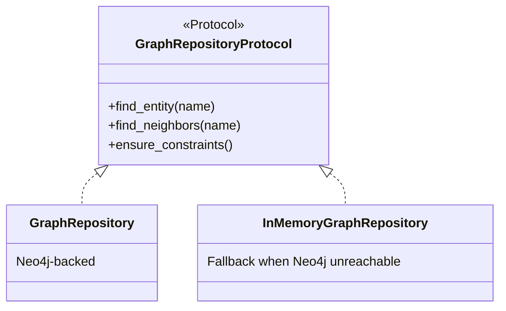

# Backend Architecture

FastAPI + async SQLAlchemy + LangGraph, Python 3.13. No ORM framework magic —
every repository is an explicit `Protocol` plus one or more concrete
implementations, wired together once at startup.

## Module map

```
backend/app/
├── main.py               # composition root — every dependency built here, once
├── core/                 # settings (Pydantic Settings), logging
├── documents/             # loaders (PDF/TXT/MD) + chunking
├── embeddings/            # embedder abstraction (real model + hashing fallback)
├── entity_extraction/      # GLiNER + regex + LLM validator
├── relation_extraction/    # rule-based relation extraction
├── ontology/               # entity labels, relation types, hierarchy
├── graph/                  # KnowledgeGraphBuilder
├── repositories/           # GraphRepository, VectorRepository, MetadataRepository, LearningRepository
├── retrieval/              # BM25, hybrid fusion, graph expansion, reranker
├── planning/               # Task Graph Planner + Executor
├── evidence/               # Evidence Fusion Engine, Evidence Graph
├── reasoning/              # Industrial Reasoning Graph builder
├── contradiction/          # Contradiction Detector
├── recommendation/         # Recommendation Engine
├── narration/              # LLM Narrator (final report stage)
├── agents/                 # 8 LangGraph agent wrappers (one per pipeline stage)
├── orchestrator/           # LangGraph StateGraph wiring the 8 agents together
├── services/               # ChatService, IngestionService — thin API-facing facades
├── timeline/               # Timeline Engine (M4)
├── features/               # Rule-based feature extraction (M4)
├── prediction/              # Prediction Engine + rule-based models (M4)
├── feedback/                # Feedback Engine (M4)
├── evaluation/              # Metrics + evaluators (M4)
├── research/                # Experiment Manager, Benchmarks, A/B testing, synthetic data (M5)
├── ml/                      # Training, Feature Store, Registry, Inference, Explainability, Monitoring (M6)
├── api/v1/                  # FastAPI routers — one file per subsystem
└── schemas/                 # Pydantic request/response models (API boundary only)
```

## Layering rule: dataclasses inside, Pydantic at the edge

Internal domain models (`EquipmentFeatureVector`, `Prediction`, `Evidence`,
`TrainedModel`, ...) are plain `@dataclass`es — no serialization concerns, no
framework coupling. Pydantic schemas in `app/schemas/` exist **only** to
validate HTTP request/response boundaries, with an explicit `_to_out()`
converter function in each route file. This keeps the domain model framework-
agnostic and makes it trivial to reuse (e.g. the same `PredictionResult` type
is produced by both a rule-based model and a scikit-learn model).

## The repository pattern

Every persistence-backed dependency follows the same shape:



The same pattern repeats for `VectorRepository` (Qdrant / embedded local-file),
`ModelRegistryProtocol` (SQLite+joblib today; ONNX/MLflow are additive future
values, not a rewrite), and every SQL-backed repository (`LearningRepository`,
`SqlExperimentTracker`, `SqlModelRegistry`) via `Protocol` + `Sql*`
implementation.

## Composition root (`app/main.py`)

`lifespan()` is the **only** place anything is constructed. Every dependency
is built in explicit order (settings → embedder → repositories → services →
orchestrator) and attached to `app.state`. Route handlers never import a
concrete implementation — they receive `request.app.state.<service>` and
depend only on its Protocol. This is what makes the "independent subsystem"
rule enforceable: a new milestone can only reach the services already on
`app.state`, so accidentally coupling into the orchestrator's internals is
structurally awkward, not just a style rule.

## API routing

Each subsystem gets one router file in `app/api/v1/`, mounted under
`/api/v1` in [`app/api/v1/router.py`](../../backend/app/api/v1/router.py). See
[docs/api/README.md](../api/README.md) for the full endpoint reference.

## Testing philosophy

Zero mocking of internal collaborators beyond simple fakes/stubs (no mocking
frameworks) — every business-logic test exercises real logic against an
in-memory/temp-file backend (SQLite via `tmp_path`, `InMemoryGraphRepository`)
or a hand-written fake implementing the same Protocol. Since v1.0.1, API
route handlers also have automated `TestClient` coverage (`tests/test_api_*.py`,
one file per router, sharing a session-scoped app fixture) alongside the live
smoke testing documented in each milestone's release notes — see
[docs/contributing/testing.md](../contributing/testing.md#api-layer-tests-v101).
