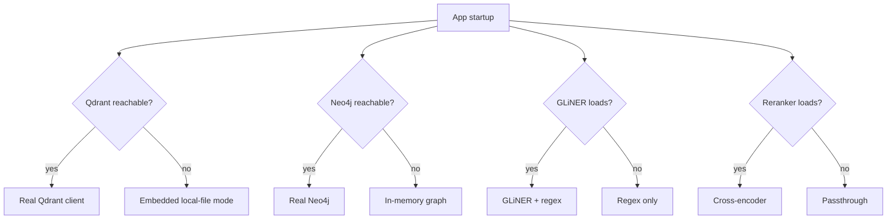

# Deployment Architecture

## Principle: nothing is required to run

Every heavy or external dependency is optional. The app starts and serves a
fully working (if degraded) experience with **zero external services running**
— no Docker, no API key, no downloaded model required. Each `build_*()`
factory function in the composition root attempts the real thing first and
falls back automatically, logging a `WARNING` so degraded mode is always
visible, never silent.

## Fallback matrix

| Dependency | Real implementation | Fallback | Trigger |
| --- | --- | --- | --- |
| Vector store | Qdrant server (`:6333`) | Qdrant embedded local-file mode (`./.qdrant_local`) | `QdrantClient(url=...).get_collections()` fails |
| Knowledge graph | Neo4j (`:7687`) | `InMemoryGraphRepository` (not persisted across restarts) | `driver.verify_connectivity()` fails |
| Embeddings | `SentenceTransformerEmbedder` (real model) | `HashingEmbedder` (deterministic, degraded quality) | Model fails to load |
| Entity extraction | GLiNER zero-shot NER + regex | Regex-only | GLiNER model fails to load |
| Reranking | Cross-encoder (`ms-marco-MiniLM-L-6-v2`) | `PassthroughReranker` (preserves fusion rank order) | Model fails to load |
| LLM narration | Anthropic API | `MockLLMProvider` (deterministic, offline) | `LLM_PROVIDER != "anthropic"` or no API key |



**What degrades in fallback mode**: knowledge graph persistence across
restarts (in-memory mode), retrieval/reranking quality (hashing embedder /
passthrough reranker), and entity extraction recall for entities without a
structured tag pattern (regex-only). **What still works fully**: chat,
reasoning, contradiction detection, recommendations, predictions, ML Lab
training, and the Research framework — none of them require the optional
services above.

## Startup performance

The five fallback checks above (embedder, Qdrant, Neo4j, GLiNER, reranker)
were originally attempted sequentially in `lifespan()`, each blocking the
next. Since v1.0.1 they run concurrently via `asyncio.to_thread` +
`asyncio.gather` — they're independent at construction time, so cold-start
time is bounded by the slowest single check rather than their sum, in
principle.

**Honest measured results** (this development environment, all five checks
falling back — no Docker, no models available):

| Run | Sequential (pre-v1.0.1) | Concurrent (v1.0.1) |
| --- | --- | --- |
| 1 | ~25s | ~20s |
| 2 | ~30s | ~20s |
| 3 | ~31s | 38s (anomalous) |

The concurrency change is real and measurable, but modest — roughly 20-35%
faster on typical runs — not the 2-3x reduction a naive analysis would
predict. All five checks are network-bound (HTTP/DNS resolution attempts to
unreachable hosts, or Hugging Face Hub cache/lock contention when multiple
model-loading attempts run at once), and their individual durations vary run
to run more than they parallelize cleanly. One run measured 38s — slower
than any sequential baseline — which is reported here rather than omitted:
a benchmark that only shows the favorable runs is not a benchmark. Reported
per the same "never fabricate" standard as [docs/benchmarks/](../benchmarks).

## Local development (Docker available)

```bash
docker compose up -d      # Qdrant + Neo4j
cd backend && uvicorn app.main:app --reload --port 8000
cd frontend && npm run dev
```

See [`docker-compose.yml`](../../docker-compose.yml) — two services, no
orchestration beyond that (no Postgres/Redis/MinIO; SQLite substitutes for
metadata/learning/experiment/ML-registry stores at this stage — see
[docs/roadmap/README.md](../roadmap/README.md) for the target end-state).

## Environments

| | Development | Production |
| --- | --- | --- |
| Backend | `uvicorn app.main:app --reload` | `uvicorn app.main:app --workers N` (no `--reload`) |
| Frontend | `npm run dev` (Vite dev server, HMR) | `npm run build` → serve `dist/` as static assets |
| Databases | SQLite files, embedded Qdrant, in-memory graph acceptable | Real Qdrant + Neo4j strongly recommended; SQLite is a known scaling limit — see [SECURITY.md](../../SECURITY.md#scope-notes) |
| LLM | `mock` (default) | `anthropic` with a real key |

See [`run-dev.ps1`/`run-dev.sh`](../../run-dev.sh) and
[`run-prod.ps1`/`run-prod.sh`](../../run-prod.sh) for the scripted versions of
both.

## What would change for a real production deployment

This is a portfolio/research-grade deployment, not a hardened production
one — see [SECURITY.md](../../SECURITY.md#scope-notes) for the explicit
scope boundary. Moving further would mean: Postgres instead of SQLite for the
four local databases, a managed Qdrant/Neo4j cluster, secrets via a vault
instead of `.env`, and horizontal scaling of the FastAPI process behind a load
balancer — none of which require changing application code, since every
storage dependency is already behind a `Protocol`.
