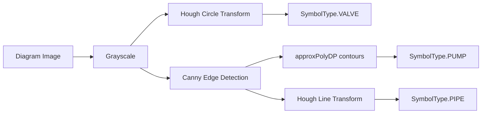

# Engineering Diagram Understanding (M7 Component 3)

[`ClassicalCVDiagramParser`](../../backend/app/vision/diagram/parser.py) detects
P&ID-style symbols via classical computer vision, not a trained symbol
classifier: Hough circles for valve/instrument dials, quadrilateral contours
for equipment blocks, and Hough line segments for pipes.

## Why classical CV, not a trained classifier

This is deliberately simple and explainable, not a fake capability. A real
deep-learning diagram symbol classifier (trained on a labeled P&ID symbol
dataset) is the documented upgrade path. `DiagramParser` is duck-typed (any
class with `parse(image_path, image_id) -> list[DiagramSymbol]` is valid) so
that upgrade is a new class, not a rewrite of anything that calls this one —
`VisionKnowledgeGraphBuilder` and the API layer never change.

## Detection parameters

| Symbol | Method | Key parameters | File |
| --- | --- | --- | --- |
| Valve / instrument dial | `cv2.HoughCircles` | `minRadius=8, maxRadius=80, param2=30` | `_detect_circles` |
| Equipment block / pump | `cv2.findContours` + `approxPolyDP` | `_MIN_EQUIPMENT_CONTOUR_AREA=200`, exactly 4 vertices | `_detect_equipment_blocks` |
| Pipe | `cv2.HoughLinesP` | `_MIN_PIPE_LINE_LENGTH=40`, `maxLineGap=5` | `_detect_pipes` |

Every symbol carries its raw detection confidence (0.5-0.6, not calibrated
against labeled ground truth — an honest starting estimate, not a measured
precision) and bounding box, so a human reviewer (or the Vision Workspace) can
correct a coarse label without losing the underlying detection.

## Known limitation, stated plainly

Classical shape detection **cannot distinguish** a "pump" rectangle from a
generic equipment-block rectangle, or a "valve" circle from a "gauge" circle
— every rectangle detected here is labeled `PUMP` and every circle `VALVE`.
This is coarse but real detection, not random noise:
[`vision_demo_data/README.md`](../../vision_demo_data/README.md) documents a
reproduced, honestly-reported case where the parser correctly finds a P&ID's
valve circle and several pipe segments, but does **not** reliably find the
pump rectangle in that composite multi-shape scene — even though an isolated
single rectangle is correctly detected
([`test_vision_diagram.py`](../../backend/tests/test_vision_diagram.py)).
Overlapping shapes and text measurably increase contour-detection noise
versus an isolated shape; this is expected classical-CV behavior, not a bug
quietly worked around.

## Ontology mapping

[`ontology_label_for_symbol()`](../../backend/app/vision/diagram/parser.py) maps
a detected `SymbolType` to an `EntityLabel`:

| `SymbolType` | `EntityLabel` |
| --- | --- |
| `VALVE` | `VALVE` |
| `PUMP` | `PUMP` |
| `PIPE` | `PIPE` |
| `SENSOR` | `SENSOR` |
| `INSTRUMENT` | `INSTRUMENT` |
| `FLOW_ARROW`, `LABEL` | `None` — still becomes a `DiagramSymbol` graph node, just not `ASSOCIATED_WITH` a domain entity |

## Measuring it

[`DiagramParsingBenchmark`](../../backend/app/research/benchmarks/vision_runners.py)
(`POST /research/benchmarks/vision_diagram_parsing/run`) measures symbol-type
recall against a single known synthetic P&ID scene — see
[research.md](research.md) for why single-scene benchmarks understate
real-world variance, and [`generate_benchmark_reports.py`](../../backend/scripts/generate_benchmark_reports.py)
for the fuller measured picture.
