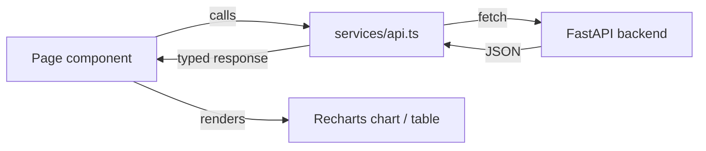

# Frontend Architecture

Vite + React 19 + TypeScript + Tailwind CSS. Deliberately minimal — no state
management library, no router, no component framework. Four workspaces, one
shared typed API client.

```
frontend/src/
├── App.tsx              # tab navigation: Chat / Documents / Research / ML Lab
├── main.tsx              # React root
├── pages/
│   ├── ChatPage.tsx       # ask a question, see cited answer + reasoning + contradictions
│   ├── DocumentsPage.tsx  # upload, list ingested documents
│   ├── ResearchPage.tsx   # M5: run benchmarks, A/B tests, view calibration + experiment history
│   └── MLLabPage.tsx      # M6: train models, view metrics/ROC/calibration/confusion matrix, registry, feature store
└── services/
    └── api.ts             # every backend call + response type, one function per endpoint
```

## Why no router or state library

Four tabs, each independently fetching its own data via `useEffect` +
`useState`, is simpler and more debuggable than introducing Redux/Zustand/
React Router for an app this size. Each page component owns its own loading/
error state. This is a deliberate "favor clarity over cleverness" choice, not
an oversight — see [CONTRIBUTING.md](../../CONTRIBUTING.md).

## Data flow



Every backend response has a corresponding TypeScript interface in `api.ts`
(e.g. `ChatResponse`, `Experiment`, `MLTrainingResult`) — no `any`, no loose
JSON parsing in components.

## Charting

[Recharts](https://recharts.org) is used throughout (Research and ML Lab) for
F1/latency trends, ROC curves, calibration curves, confusion matrices, and
feature importance bars — all rendered from real API responses, never
hardcoded sample data.

## Styling

Tailwind utility classes only, no CSS-in-JS, no component library. Consistent
`rounded-lg border border-slate-200 p-4` card pattern across all four pages.

## Adding a new workspace

1. Add the endpoint types + fetch functions to `services/api.ts`.
2. Create `pages/YourPage.tsx` following the existing card-per-section layout.
3. Add the tab to `App.tsx`'s `Tab` union, `TAB_LABELS`, and the render ternary.

No other file needs to change — this is how ML Lab (M6) was added without
touching Chat, Documents, or Research.
