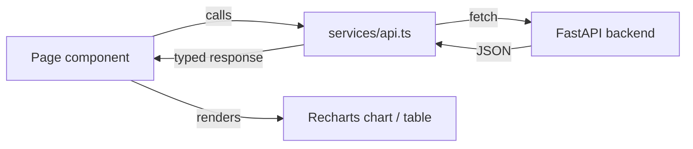

# Frontend Architecture

Vite + React 19 + TypeScript + Tailwind CSS. Deliberately minimal — no state
management library, no router, no component framework. Five workspaces, one
shared typed API client.

```
frontend/src/
├── App.tsx              # tab navigation: Chat / Documents / Research / ML Lab / Vision
├── main.tsx              # React root
├── pages/
│   ├── ChatPage.tsx       # ask a question, see cited answer + reasoning + contradictions
│   ├── DocumentsPage.tsx  # upload, list ingested documents
│   ├── ResearchPage.tsx   # M5: run benchmarks, A/B tests, view calibration + experiment history
│   ├── MLLabPage.tsx      # M6: train models, view metrics/ROC/calibration/confusion matrix, registry, feature store
│   ├── VisionPage.tsx     # M7.1: upload/analyze images, overlay viewer, Knowledge Graph panel, multimodal query, vision benchmarks
│   └── VisionPage.test.tsx # M7.1: the first page with an automated test suite (see Testing below)
├── test/
│   └── setup.ts          # M7.1: jest-dom matchers + RTL cleanup, loaded by vitest.config.ts
└── services/
    ├── api.ts             # every backend call + response type, one function per endpoint
    └── api.vision.test.ts # M7.1: fetch-mocked tests for the Vision API functions
```

## Why no router or state library

Five tabs, each independently fetching its own data via `useEffect` +
`useState`, is simpler and more debuggable than introducing Redux/Zustand/
React Router for an app this size. Each page component owns its own loading/
error state. This is a deliberate "favor clarity over cleverness" choice, not
an oversight — see [CONTRIBUTING.md](../../CONTRIBUTING.md).

One consequence worth knowing: switching tabs unmounts the previous page
component (`App.tsx`'s render ternary), so a page's in-memory state (selected
image, typed query, zoom level) resets on tab switch — server-persisted state
(uploaded images, trained models, experiments) survives via each page's
mount-time fetch, only client-only UI state is lost. This is consistent
across all five pages, not a Vision-specific limitation.

## Data flow



Every backend response has a corresponding TypeScript interface in `api.ts`
(e.g. `ChatResponse`, `Experiment`, `MLTrainingResult`) — no `any`, no loose
JSON parsing in components.

## Charting

[Recharts](https://recharts.org) is used throughout (Research and ML Lab) for
F1/latency trends, ROC curves, calibration curves, confusion matrices, and
feature importance bars — all rendered from real API responses, never
hardcoded sample data.

## Styling

Tailwind utility classes only, no CSS-in-JS, no component library. Consistent
`rounded-lg border border-slate-200 p-4` card pattern across all five pages.
No dark mode anywhere. The Vision Workspace uses a wider `max-w-7xl` container
(the other four use `max-w-3xl`/`max-w-4xl`) since its three-column upload/
viewer/results layout genuinely needs the space — the only intentional
deviation from the shared container width.

## Bounding-box overlays (Vision Workspace)

Detection/OCR/defect/gauge/diagram-symbol boxes are drawn as an absolutely-
positioned `<svg>` sitting on top of the ``, with
`viewBox="0 0 {naturalWidth} {naturalHeight}"` and `preserveAspectRatio="none"`
— every box's coordinates are the backend's raw pixel values, and the SVG
viewBox handles all the scaling automatically regardless of the current zoom
level or the image's rendered size. No coordinate-transform math lives in the
frontend. Hover tooltips are native SVG `<title>` elements (real browser
tooltips, not a custom-positioned div) — a deliberately simple choice that
satisfies the requirement without extra state.

## Testing

**Vision (M7.1) is the first page in this frontend with an automated test
suite** — no prior page had one; Vitest + React Testing Library +
`@testing-library/user-event` + jsdom were added from scratch
(`vitest.config.ts`, `src/test/setup.ts`). `npm test` runs it. Two files:
`services/api.vision.test.ts` (fetch-mocked unit tests for every Vision API
function) and `pages/VisionPage.test.tsx` (upload flow, drag-and-drop,
analysis, overlay rendering/selection/zoom, Knowledge Graph panel,
multimodal query, research benchmarks, error states). A shared
`afterEach(cleanup)` in `src/test/setup.ts` is required for RTL to unmount
between tests since this project doesn't set Vitest's `globals: true` —
forgetting it causes every test after the first to see duplicated DOM from
prior renders, which is exactly what happened once during development before
the setup file was fixed.

## Adding a new workspace

1. Add the endpoint types + fetch functions to `services/api.ts`.
2. Create `pages/YourPage.tsx` following the existing card-per-section layout.
3. Add the tab to `App.tsx`'s `Tab` union, `TAB_LABELS`, and the render ternary.

No other file needs to change — this is how ML Lab (M6) and Vision (M7.1)
were both added without touching any other page.
