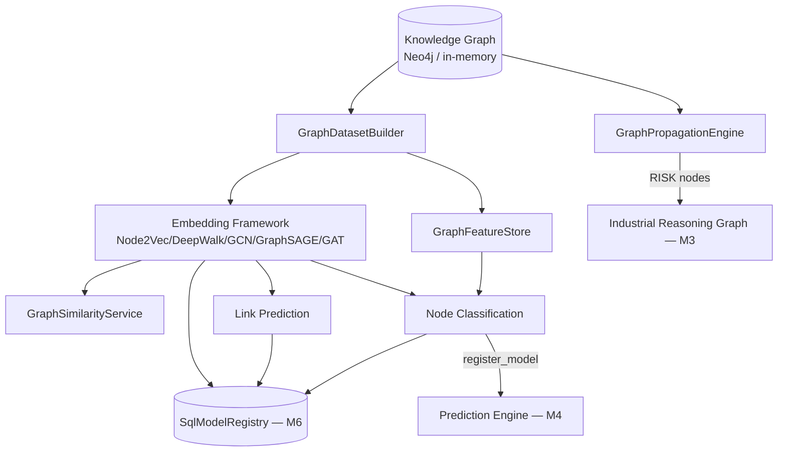

# Graph Intelligence (M9)

The Knowledge Graph stops being read only by traversal and rules. M9 adds a
graph representation learning layer underneath it — node embeddings, link
prediction, node classification, and risk propagation — all under
[`app/graph_intelligence/`](../../backend/app/graph_intelligence). The
objective was never "add Graph Neural Networks" as an end in itself; it's to
give the existing symbolic Reasoning/Prediction/Recommendation stack another,
genuinely different reasoning source to draw on.

## Design principle: another reasoning source, not a replacement

Symbolic reasoning (M3) and rule-based prediction (M4) are unchanged. Graph
embeddings sit *alongside* them: `GraphPredictionModel` implements the exact
same `PredictionModel` Protocol M4's rule models and M6's `MLPredictionModel`
do, so `PredictionEngine.register_model()` can swap a graph model into a
serving slot without either of those modules knowing anything changed.
Nothing here bypasses the Knowledge Graph or Evidence Fusion — every M9
computation starts from the same `GraphRepository` M3 already built.

## No parallel infrastructure

Every trained artifact this milestone produces — an `EmbeddingResult`, a
`LinkPredictionModel`, a graph-embedding `TrainedModel` — is a plain,
`joblib`-serializable Python object (embedding vectors are `list[float]`, not
live tensors). All of them register into the *same* `SqlModelRegistry` M6
built. A graph node-classification model shares its `task_type` value with
M6's classical models for that task (e.g. `failure_risk`) and is
distinguished only by an `algorithm` field prefixed `graph_` — so
`GET /ml/models?task_type=failure_risk` already lists a rule-based, a
classical ML, and a graph model side by side, with no new registry query.
Component 10 ("ML Laboratory Integration") is, by this design, mostly
*already done* by the time Components 1–7 exist — the only code written
specifically for it was surfacing feature importance in the node
classification API response (see below).

## 1. Graph Dataset Builder

[`GraphDatasetBuilder`](../../backend/app/graph_intelligence/dataset/builder.py)
pulls every node and edge from `GraphRepository.all_nodes()`/`all_edges()`
(added this milestone) and builds a `GraphDataset` — nodes sorted by id for
deterministic ordering, so every export is reproducible across repeated
`build()` calls against the same graph state. Export targets:

- **PyTorch Geometric**: `to_pyg_homogeneous()` (one-hot node-type feature
  matrix by default, or caller-supplied features) and
  `to_pyg_heterogeneous()` (one `HeteroData` block per node type, edge blocks
  keyed by `(source_type, relation_type, target_type)` triples)
- **NetworkX**: `to_networkx()`
- **CSV**, **GraphML**, **JSON**: `to_csv()` / `to_graphml()` / `to_json()`
- **DGL**: architecture-only for now (the same `GraphDataset` shape maps
  directly; no DGL-specific code exists yet — see Roadmap)

Multimodal node types (Image, OCRRegion, DetectedObject, Defect,
GaugeReading, DiagramSymbol from M7's Vision Knowledge Graph) come through
automatically since they're already regular nodes in the same graph — no
special-casing was needed. Temporal edges are architecture-only: `GraphEdge`
and `GraphNode` both carry an optional `timestamp` field today, with no
consumer yet.

## 2. Graph Feature Store

[`GraphFeatureStore`](../../backend/app/graph_intelligence/feature_store/store.py)
reuses M6's `FeatureDefinition` metadata model rather than inventing a
parallel one. Two feature families, computed once per `build()`:

- **Structural** (`structural_features()`): degree, PageRank, betweenness
  centrality, and community id — all via `networkx` plus
  `community_louvain.best_partition()` on the undirected graph.
- **Domain** (`compute_node_features()`, async): maintenance count, incident
  count, visual observation count (nodes matching M7's
  `EntityLabel.VISUAL_EVIDENCE` descendants), OCR confidence average,
  defect count, prediction confidence, and recommendation acceptance rate —
  each sourced from the real `GraphRepository`/`LearningRepository`, not
  fabricated.

`NodeFeatures` combines both families per node. `compute_all()` orchestrates
the full computation across every node in a dataset.

## 3. Embedding Framework

Three Protocols in
[`embeddings/base.py`](../../backend/app/graph_intelligence/embeddings/base.py) —
`NodeEmbeddingModel`, `EdgeEmbeddingModel`, `GraphEmbeddingModel` — are the
only contract the rest of the system depends on. **Nothing outside
`app/graph_intelligence/embeddings/` imports `torch_geometric` or `gensim`
directly**, satisfying the spec's "do not couple the system to PyTorch
Geometric."

| Model | Backend | Notes |
| --- | --- | --- |
| `Node2VecEmbedding` | `gensim.Word2Vec(sg=1)` over biased random walks | `p`/`q` control the second-order bias |
| `DeepWalkEmbedding` | subclasses `Node2VecEmbedding` with `p=q=1.0` | DeepWalk *is* Node2Vec's unbiased special case — a thin subclass, not a duplicate implementation |
| `GCNEmbedding` / `GraphSAGEEmbedding` / `GATEmbedding` | `torch_geometric.nn` convolutions | trained unsupervised via link-prediction negative sampling (dot-product positive-edge score vs. a randomly sampled negative-edge score, binary cross-entropy) — standard practice with no node labels available |

`HadamardEdgeEmbedding` (elementwise product of two node vectors) and
`MeanPoolingGraphEmbedding` (mean of all node vectors) implement the edge-
and graph-level embedding interfaces on top of any node embedding.

Future heterogeneous GNNs (relation-type-aware convolutions) are a
documented roadmap item — `to_pyg_heterogeneous()` already produces the
`HeteroData` shape they'd consume.

## 4/6. Graph Intelligence Models & Node Classification

[`node_classification.py`](../../backend/app/graph_intelligence/node_classification.py)
reuses `MLProblemType.GRAPH` — a value M6's `SklearnTrainer` already declared
but deliberately left without a default algorithm ("faking one would produce
a trained model that's really just noise"). `_default_graph_trainer()`
supplies a real `RandomForestRegressor` factory — the literal extension
point M6 built for this milestone, not a parallel training path.

**Honest training target**: no real ground-truth risk/priority labels exist
for graph nodes, so rather than fabricate them,
`GraphNodeClassificationTrainer.fit_against_rule_baseline()` trains a
graph-embedding regressor to reproduce the *existing rule-based
`PredictionModel`'s own output* for the same `task_type`. This is a genuine
two-computation-paths comparison (explicit rule features vs. graph-structure
embeddings targeting the same real quantity) — not two models fit to
invented numbers. It returns `None` rather than a degenerate model when
fewer than 2 equipment ids resolve to both a graph embedding and a rule
target, mirroring `SklearnTrainer`'s own anti-fabrication discipline.

`GraphPredictionModel` implements `PredictionModel` exactly like M4's rule
models and M6's `MLPredictionModel` — a third, drop-in-compatible
implementation. Its confidence is an honest ensemble-variance proxy (lower
spread across the forest's individual tree predictions → higher confidence),
the same "real but simple heuristic" standard M6 held its own uncertainty
proxy to.

## 5. Link Prediction

[`link_prediction.py`](../../backend/app/graph_intelligence/link_prediction.py):
`LinkPredictionTrainer.fit()` trains a `LogisticRegression` over Hadamard
edge embeddings — positive examples are real edges, negatives are randomly
sampled non-edges (2× the positive count). `LinkPredictor.top_candidates()`
ranks all non-connected nodes for a given source and excludes
already-connected targets. Every candidate carries confidence, embedding
similarity, and a human-readable explanation — never a bare score.

## 7. Risk Propagation

[`propagation.py`](../../backend/app/graph_intelligence/propagation.py):
`GraphPropagationEngine.propagate()` does a decayed BFS from a source node
(`initial_risk × decay_factor^depth`) across five propagation types
(failure, leak, maintenance delay, inspection gap, compliance violation).
Results convert directly into `ReasoningNode(node_type=ReasoningNodeType.RISK)`
entries — `RISK` was already a value M3's `ReasoningNodeType` declared — and
merge into an existing `IndustrialReasoningGraph` via
`merge_into_reasoning_graph()`, so propagation output folds into the same
reasoning graph the Cognitive Engine already produces, rather than living in
a separate structure.

## Graph Intelligence API

`app/graph_intelligence/orchestration.py` exposes the two top-level classes
the API layer talks to:

- **`GraphEmbeddingTrainer`** — builds a dataset, trains an embedding model,
  registers it (`task_type="graph_embedding"`)
- **`GraphInferenceEngine`** — loads the latest registered embedding,
  trains a link predictor (`task_type="graph_link_prediction"`) or a node
  classifier (registered under the classical model's own `task_type`,
  `algorithm=f"graph_{algorithm}"`) on demand

`GraphDatasetBuilder`, `GraphFeatureStore`, `GraphSimilarityService`
(cosine-similarity nearest neighbors), `GraphPropagationEngine`, and
`GraphExplanationService` are constructed once in `main.py` and injected via
`request.app.state` — the same dependency-injection convention every prior
milestone uses.

### REST surface (`/api/v1/graph-intelligence`)

| Method | Path | Purpose |
| --- | --- | --- |
| GET | `/summary` | Node/edge counts, distinct types |
| GET | `/graph` | Full node-link export with community id, for the frontend graph widget |
| GET | `/features/{equipment_name}` | Structural + domain features for one node |
| GET | `/embeddings/models` | Available embedding model names |
| POST | `/embeddings/train` | Train and cache an embedding (`model_name`, `dimensions`) |
| GET | `/similarity/{equipment_name}` | Nearest neighbors by cosine similarity |
| GET | `/explain/{equipment_name}` | Full explanation (neighbors, edges, community, confidence, human-readable text) |
| POST | `/link-prediction/candidates` | Ranked link-prediction candidates for a source node |
| POST | `/node-classification/train` | Train a graph model against the rule baseline, register it, return feature importance |
| POST | `/propagation/simulate` | Simulate risk propagation from a source node |

## Explainability

Every graph prediction exposes nearest neighbors, important edges, community
id, supporting evidence, and confidence via `GraphExplanationService` — never
a bare number. For node classification specifically,
`POST /node-classification/train` also runs the *same* `Explainer` M6's
classical models use (`app/ml/explainability/explainer.py`) against the
graph model's real `RandomForestRegressor` estimator — `feature_importances_`
works unmodified, since the estimator is a genuine scikit-learn object.
Feature names are embedding dimensions (`dim_0`, `dim_1`, …) rather than
domain features — an honest reflection of what a graph-embedding model
actually learns from, not a limitation hidden from the caller.

Model monitoring is likewise unmodified: `ModelMonitor.prediction_drift()`
(Population Stability Index) operates on plain `list[float]` predictions
regardless of whether they came from a rule, a classical ML model, or a
graph model — no graph-specific drift mechanism exists or is needed.

## Frontend

The **Graph Intelligence** workspace
(`frontend/src/pages/GraphIntelligencePage.tsx`) uses **Cytoscape.js**
(selected over react-force-graph/custom D3 for its native expand/collapse,
filtering, and mature zoom/pan/highlight) for the interactive graph, plus
Recharts bar charts (already used elsewhere in the app) for the similarity
score and feature importance views — no new charting dependency. It covers:
node type/name filtering, node feature lookup, embedding training,
similarity search with explanations, link prediction, risk propagation
simulation, node classification training with a live model registry table
(tagged **Graph** vs **Classical** by the `graph_` algorithm prefix — the
same distinguishing signal the backend registry design relies on), and
on-demand research benchmarks.

## Research Integration

[`app/research/benchmarks/graph_runners.py`](../../backend/app/research/benchmarks/graph_runners.py)
extends the M5 Benchmark Suite with the same "small deterministic synthetic
graph, measure the real production component" discipline M7's vision
benchmarks established. See
[docs/benchmarks/README.md](../benchmarks/README.md#graph-intelligence-benchmarks)
for real numbers, including one deliberately unedited result: on this small
synthetic dataset, the rule baseline currently *beats* the graph-embedding
node classifier — a legitimate outcome from a simple baseline against a weak
sample size, reported as-is rather than tuned away.

## Roadmap

- Heterogeneous, relation-type-aware GNN layers (the `to_pyg_heterogeneous()`
  export already produces the `HeteroData` shape they'd consume)
- DGL export (`GraphDataset` already has everything needed; no DGL-specific
  code exists yet)
- Real temporal graph learning (the `timestamp` field on `GraphNode`/
  `GraphEdge` is architecture-only today)
- SHAP-based explanations for graph models (same documented extension point
  M6's `Explainer` already has for classical models)
