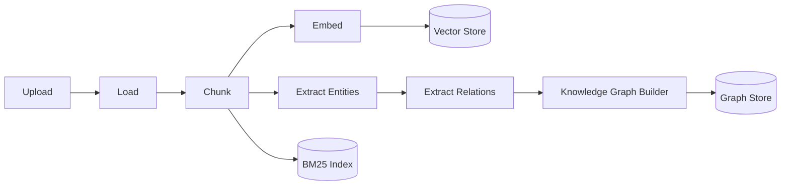

# Document Ingestion

## Pipeline

Implemented in [`IngestionService.ingest()`](../../backend/app/services/ingestion_service.py) —
one synchronous call chain per upload, no background job queue. Every stage is
injected (`Embedder`, `VectorRepository`, `EntityExtractionService`,
`RelationExtractor`, `KnowledgeGraphBuilder`), so swapping any one of them
never requires touching this file.

## Supported formats today

| Format | Loader | Notes |
| --- | --- | --- |
| `.pdf` | [`pdfplumber`](https://github.com/jsvine/pdfplumber) text-layer extraction | Text-layer PDFs only — **not OCR**. A scanned/image-only PDF yields empty page text. |
| `.txt` | plain read | UTF-8, errors ignored |
| `.md` | plain read | Treated as plain text, no Markdown structure parsing |

**Honest scope note:** OCR (scanned documents), DOCX/XLSX parsing, and
structure-preserving layout extraction (tables, figures, headings as distinct
elements) are **documented future work**, not implemented — see the docstring
in [`app/documents/loaders.py`](../../backend/app/documents/loaders.py). Adding a
loader is a single new function registered in `_LOADERS`; nothing else in the
pipeline changes.

## Chunking

[`chunk_pages()`](../../backend/app/documents/chunking.py) splits each page along
paragraph boundaries (`\n\n`) into ~800-character chunks with 120 characters of
trailing overlap carried into the next chunk — coherent units for embedding and
retrieval rather than arbitrary character windows, while keeping enough context
across a chunk boundary that retrieval doesn't lose the tail of an idea.

## What happens per chunk

1. **Embed** — `Embedder.embed_texts()` (real sentence-transformer model, or a
   deterministic hashing embedder if the model can't load — see
   [deployment.md](deployment.md)) → upserted into the vector store, alongside
   a BM25 posting list update.
2. **Extract entities** — `EntityExtractionService.extract()` runs GLiNER
   (zero-shot NER) and a regex extractor over the chunk text; see
   [knowledge-graph.md](knowledge-graph.md#entity-extraction).
3. **Extract relations** — `RelationExtractor.extract()` runs rule-based
   relation extraction over co-occurring entities within the chunk.
4. **Build graph** — `KnowledgeGraphBuilder.build()` upserts entities/relations
   into the graph store for the whole document in one call.

## Metadata tracking

[`MetadataRepository`](../../backend/app/repositories/metadata_repository.py)
(SQLite) records one row per document — filename, content type, chunk count,
entity count — surfaced via `GET /api/v1/documents`.
