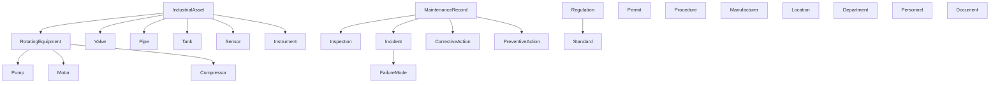
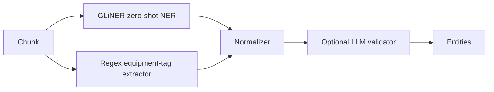

# Knowledge Graph

## Ontology

24 entity labels in an explicit is-a hierarchy (not a flat list), defined in
[`app/ontology/`](../../backend/app/ontology):

`ancestors_of()` / `descendants_of()` / `is_a()` in
[`app/ontology/hierarchy.py`](../../backend/app/ontology/hierarchy.py) let graph
queries reason at the right altitude — e.g. "show me all RotatingEquipment
incidents" without enumerating Pump/Motor/Compressor by hand.

15 relation types: `CONNECTED_TO`, `PART_OF`, `LOCATED_IN`, `INSTALLED_IN`,
`MAINTAINED_BY`, `FAILED_DUE_TO`, `INSPECTED_BY`, `REFERENCES`,
`GENERATED_FROM`, `USES_STANDARD`, `CAUSES`, `MITIGATED_BY`, `REQUIRES`,
`RELATED_TO`, and `MENTIONS` (kept distinct — a document-mentions-entity
bookkeeping edge, deliberately excluded from reasoning evidence so it doesn't
pollute retrieval; see [retrieval.md](retrieval.md#graph-expansion)).

## Entity extraction

Two extractors run on every chunk, not one-or-the-other:

- **GLiNER** ([`urchade/gliner_mediumv2.1`](https://huggingface.co/urchade/gliner_mediumv2.1)) —
  zero-shot NER against the 24 ontology labels directly, no fine-tuning
  needed. Falls back to regex-only if the model can't load (see
  [deployment.md](deployment.md)).
- **Regex** — structured equipment tag patterns (e.g. `P-101`, `V-2201A`) that
  GLiNER may miss or phrase differently.

[`app/entity_extraction/normalizer.py`](../../backend/app/entity_extraction/normalizer.py)
reconciles the two: GLiNER might extract `"Pump P-101"` while regex extracts
`"P-101"` for the same equipment — the normalizer extracts the embedded tag
pattern from within GLiNER's longer span before uppercasing, so both
extractors converge on one canonical node instead of creating duplicates.

An optional LLM validation pass (`ENABLE_LLM_ENTITY_VALIDATION`, off by
default) can additionally filter low-confidence extractions.

## Graph repository

`GraphRepositoryProtocol` has two implementations — real Neo4j
(`GraphRepository`) and `InMemoryGraphRepository`, used automatically when
Neo4j is unreachable at startup. Both support the same surface:
`find_entity`, `find_neighbors`, `incident_history`, `distinct_entity_types`,
`distinct_relation_types`, `node_count`, `edge_count`, plus write-side
`ensure_constraints`/`upsert_entity`/`upsert_relation` used by
`KnowledgeGraphBuilder`.

## Why this matters for retrieval

The knowledge graph isn't a side artifact — [`GraphExpansionStage`](../../backend/app/retrieval/graph_expansion.py)
uses it directly during retrieval to pull in graph-neighbor evidence (e.g. a
pump's related valve) that pure vector/BM25 search would miss entirely. See
[retrieval.md](retrieval.md).
