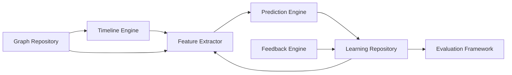

# Learning Layer (M4)

Independent of the chat orchestrator by design — its own repository, own API
routes, no changes to the M3 pipeline. Introduces rule-based prediction as the
foundation ML Lab (M6) later replaces per-task-type, without ever requiring a
rewrite.

## Timeline Engine

[`TimelineEngine`](../../backend/app/timeline/engine.py) reconstructs an
equipment's event history (`equipment_timeline`, `incident_timeline`,
`maintenance_timeline`, `full_history`) by walking the knowledge graph,
sorted deterministically by `(timestamp is None, timestamp, description)` so
undated events sort last rather than crashing a naive comparison.

## Feature Extraction

[`RuleBasedFeatureExtractor`](../../backend/app/features/extractor.py) computes
an [`EquipmentFeatureVector`](../../backend/app/features/models.py) — 17 fields
including `risk_score`, `criticality`, `ontology_depth`, `graph_degree`. Fields
the platform genuinely doesn't capture yet (`equipment_age`,
`average_repair_time`, `days_since_last_failure` when no failure is recorded)
are honestly `Optional`, never fabricated. This is the *exact same* feature
vector M6's Feature Store and ML models consume — one feature schema, two
consumers (rules, then trained models).

## Prediction Engine

[`PredictionEngine`](../../backend/app/prediction/engine.py) maps a
`PredictionTaskType` (7 values: remaining useful life, failure risk, inspection
priority, maintenance priority, recommendation priority, missing documentation
risk, compliance risk) to a `PredictionModel` — a `Protocol` with a single
`predict(features) -> PredictionResult` method. `RuleBasedPredictionModel`
implements it with explicit if/threshold logic today.

**The swap point**: `register_model(task_type, model)` lets any object
implementing the same `Protocol` replace the rule-based default at runtime —
this is the exact mechanism M6's `MLPredictionModel` uses to swap in a trained
scikit-learn model per task type, with zero changes to `PredictionEngine`
itself. See [ml-lab.md](ml-lab.md#inference-engine).

## Feedback Engine

[`FeedbackEngine`](../../backend/app/feedback/engine.py) records user feedback
(recommendation accepted/rejected, entity correction) into the Learning
Repository — the raw signal `recommendation_acceptance_rate` and confidence
calibration are computed from.

## Evaluation Framework

[`app/evaluation/`](../../backend/app/evaluation) provides reusable metric
functions (precision/recall/F1/etc.) and 8 evaluators — the same metric
functions the Research Framework's benchmarks (M5) and the ML Lab's training
pipeline (M6) both call, so "accuracy" means the same computation everywhere
in the platform.

## Learning Repository

[`SqlLearningRepository`](../../backend/app/repositories/learning_repository.py)
(SQLite) is the audit trail every prediction, outcome, feedback event,
interaction, contradiction, and model-performance metric is recorded into —
`confidence_calibration_buckets()` (joining predictions to recorded outcomes,
bucketed by confidence decile) is what powers the Calibration chart on the
Research dashboard.
