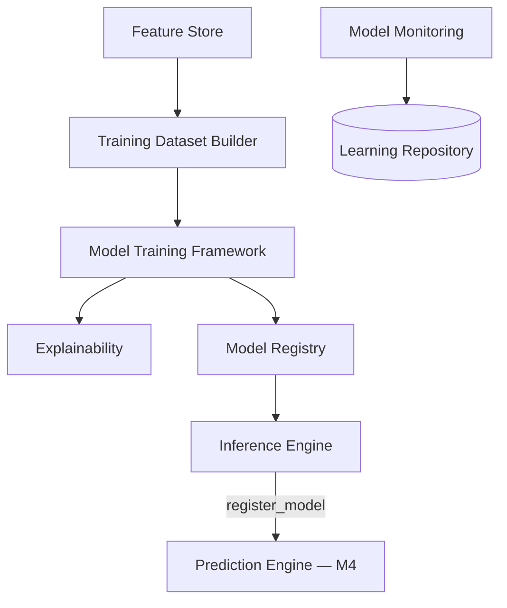

# ML Laboratory (M6)

The first milestone with *real trained* machine learning — scikit-learn, not
rules. Reasoning stays deterministic; learning becomes data-driven. Seven
subsystems, all under [`app/ml/`](../../backend/app/ml).

## 1. Training Dataset Builder

[`TrainingDatasetBuilder`](../../backend/app/ml/datasets/builder.py) turns
labeled equipment ids into a supervised pandas DataFrame via the Feature
Store — no model-specific logic. Supports `train_test_split`,
`time_series_split`, `cross_validation_folds`, `to_csv`, `to_parquet`.

**Synthetic labels**: real historical failure/priority labels don't exist yet
in this deployment (the same gap `EquipmentFeatureVector`'s `Optional` fields
already document). [`app/ml/datasets/synthetic.py`](../../backend/app/ml/datasets/synthetic.py)
generates labels from a documented formula over the real feature schema plus
Gaussian noise — learnable signal, explicitly synthetic. Only
`failure_prediction` (classification) and `maintenance_priority` (regression)
have concrete generators; the other five `MLTaskType` values follow the
identical pattern once a real label source exists.

## 2. Feature Store

[`FeatureStore`](../../backend/app/ml/feature_store/store.py) is the M4 rule-based
extractor's reusable evolution: 16 versioned `FeatureDefinition`s (name,
description, source, owner, datatype, version, generation time), TTL-cached
online (single-equipment) lookups, batch offline (DataFrame) retrieval, and
feature lineage (`risk_score` ← `failure_count`, `incident_count`,
`contradiction_rate`).

## 3. Model Training Framework

[`SklearnTrainer`](../../backend/app/ml/training/trainer.py) is generic — every
algorithm is injected via `algorithm_factories`; only the *default*
algorithm-per-problem-type table is scikit-learn-specific
(`RandomForestClassifier`/`RandomForestRegressor`/`IsolationForest`). An
XGBoost/LightGBM/PyTorch trainer would implement the same `Trainer` protocol
and swap in via the same constructor argument. `TIME_SERIES` and `GRAPH`
problem types have no default — faking one would produce noise, not a model —
`train()` raises clearly unless the caller supplies a factory.

Real evaluation metrics computed per problem type: accuracy, precision,
recall, F1, ROC-AUC, PR-AUC, Brier score (classification); RMSE, MAE
(regression). The trainer's own held-out test set (`X_test`/`y_test`) is
exposed on `TrainedModel` so downstream diagnostics (confusion matrix, ROC,
calibration) never accidentally evaluate on training rows.

## 4. Model Registry

[`SqlModelRegistry`](../../backend/app/ml/registry/repository.py) versions every
model: training data hash (`hash_dataframe` — same data in, same hash out),
hyperparameters, metrics, feature schema, timestamp, author, experiment link,
serialization path. Real `joblib` serialization to disk today;
`serialization_format` is already a plain string field so ONNX/TorchScript are
additive future values, not a schema change.

## 5. Inference Engine

[`MLPredictionModel`](../../backend/app/ml/inference/model.py) implements the
*exact same* `PredictionModel` Protocol M4's rule-based models do — a
drop-in replacement inserted into `PredictionEngine`'s model dict one task
type at a time via `register_model()`. Nothing about `PredictionEngine`
changes. Uncertainty is an honest, simple proxy: distance from a confident
classification probability, or `0.0` for regressors without a native
uncertainty estimate — not a fabricated confidence interval.

## 6. Explainability

[`Explainer`](../../backend/app/ml/explainability/explainer.py): feature
importance (`feature_importances_`/`coef_`), permutation importance
(`sklearn.inspection`), calibration curves (`sklearn.calibration`), and
decision path traversal — all real scikit-learn computations, zero new
dependencies. **SHAP is a documented extension point**, not implemented: it
would return the same `list[FeatureImportanceResult]` shape as another method
on this class, so nothing downstream would need to change to consume it.

## 7. Model Monitoring

[`ModelMonitor`](../../backend/app/ml/monitoring/monitor.py) computes Population
Stability Index in pure Python (quantile binning, no scipy) for prediction and
feature drift, with severity thresholds (`<0.1` none, `<0.25` moderate, else
significant). Concept drift and recommendation-acceptance trend reuse the
Learning Repository rather than re-implementing accuracy tracking.

## Frontend

The **ML Lab** workspace (`frontend/src/pages/MLLabPage.tsx`) trains a model on
demand, then charts feature importance, ROC curve, calibration curve, and
confusion matrix — all computed from that specific run — plus a model
registry table and the feature store's definitions.

## Why `MLTaskType` and `PredictionTaskType` are two separate enums

`MLTaskType` (training-side, 7 values) and `PredictionTaskType` (serving-side,
M4's 7 values) overlap but aren't identical — rather than force one enum to
serve both concerns, the ML Lab API explicitly maps a trained `MLTaskType`
model onto a specific `PredictionTaskType` serving slot at wiring time (e.g.
a trained `failure_prediction` model serves the `failure_risk` prediction
slot) via a small explicit dict in
[`app/api/v1/ml.py`](../../backend/app/api/v1/ml.py). This keeps "what was this
model trained to predict" and "which live prediction endpoint does it serve"
as separate, explicit concerns instead of one overloaded enum.
