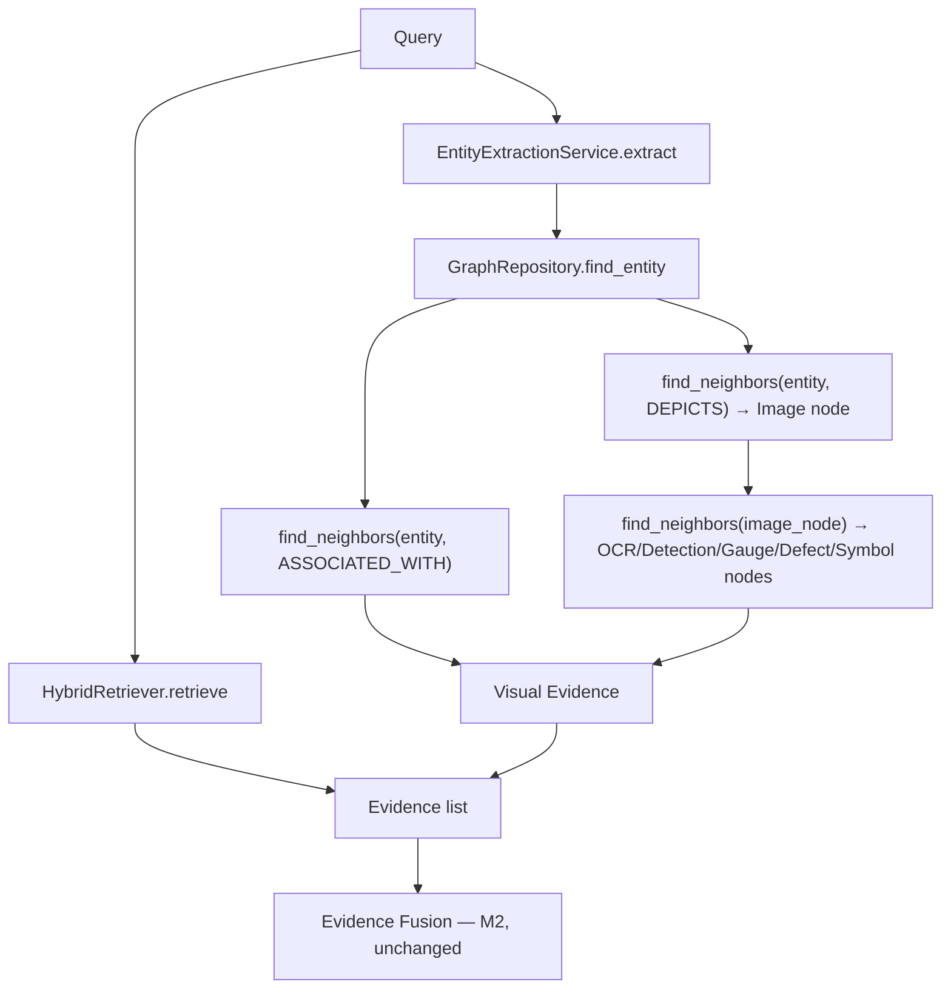

# Multimodal Retrieval (M7 Component 8)

[`MultimodalRetriever`](../../backend/app/vision/retrieval/multimodal.py) merges
text and visual evidence into **one** list — never a separate "image
answer." It's a thin composition over two things that already exist: the
M1 `HybridRetriever` and the [Vision Knowledge Graph](vision.md#vision-knowledge-graph).

## Why this satisfies "never bypass Evidence Fusion"

Visual evidence is emitted as ordinary `Evidence` instances — the exact same
dataclass (`app/retrieval/evidence.py`) text retrieval already produces, with
one convention: `source=f"vision:{node_type}"` (e.g. `vision:OCRRegion`,
`vision:Defect`). `EvidenceFusionEngine`, `ContradictionDetector`, and
`ReasoningGraphBuilder` needed **zero code changes** — they already consume
`Evidence` generically by field, not by `source` value. This was a deliberate
choice over inventing a new "Multimodal Evidence" type: reuse, not a parallel
representation.

## How a query resolves to visual evidence

1. `EntityExtractionService.extract()` runs on the query text (wrapped in a
   synthetic single-`Chunk`), exactly as it would on ingested document text.
2. For each extracted entity, `GraphRepository.find_entity()` resolves it to
   a graph node — the same lookup Graph Expansion (M1) already performs.
3. Two paths gather attached vision nodes, deduplicated via a `seen_node_ids`
   set so mentioning the same equipment twice in one query never double-counts:
   - **Direct**: nodes `ASSOCIATED_WITH` the entity (diagram symbols,
     detections whose `equipment_type` resolved to this entity).
   - **Via image**: nodes `DEPICTS`-linked images, then every vision node
     attached to that image (OCR regions, gauge readings, defects, detections).
4. Each vision node becomes one `Evidence`, with `confidence` and
   `image_node_id` read back via `get_node_properties()` (see below) and
   `text` produced by `_describe_node()` — a human-readable sentence per node
   type ("OCR read the text 'P-101' in an image.", "Visual inspection
   detected a medium-severity corrosion in an image."), never a raw dict.

## Why node properties are duplicated, not read from `find_neighbors`

`find_neighbors()` is a widely-used, shared method across the whole
reasoning/retrieval pipeline — its Cypher/in-memory `RETURN` clause doesn't
project a node's first-class `confidence` field, and widening that shared
contract for one new consumer was judged too broad a change. Instead,
[`VisionKnowledgeGraphBuilder`](../../backend/app/vision/graph/builder.py)
duplicates `confidence` and `image_node_id` into each vision node's own
`properties` dict at write time, retrievable via
`GraphRepositoryProtocol.get_node_properties(node_id)` — a small, new,
additive method (added alongside a real pre-existing bug fix: the Neo4j
`GraphRepository.create_node()` previously accepted a `properties` argument
but silently never persisted it).

## Graceful degradation

`retrieve()` catches exceptions from the text retriever (e.g. querying before
any document has ever been ingested, so the vector store's collection
doesn't exist yet) and degrades to visual-evidence-only rather than a 500 —
the same "log and continue, don't crash the whole response" discipline
`TaskGraphExecutor` already applies per task node in the M1 pipeline. A fresh
deployment queried before its first upload is a legitimate state, not a bug.

## API

`POST /vision/query` — see [docs/api/README.md](../api/README.md#vision-m7).

## Measuring it

[`MultimodalRetrievalBenchmark`](../../backend/app/research/benchmarks/vision_runners.py)
measures visual-evidence retrieval recall/false-positive-rate against its own
isolated synthetic graph (never the live production graph) — see
[research.md](research.md).

## Limitations

- Resolution depends entirely on `EntityExtractionService` recognizing the
  equipment tag in the query text — a misspelled or unrecognized tag returns
  no visual evidence, the same limitation graph-based text retrieval already has.
- No ranking/reranking across text vs. visual evidence today — they're
  concatenated, not merged by a unified relevance score. A future extension
  point, not implemented in M7.
