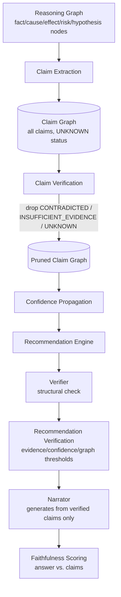

# Faithful Cognitive Reasoning (O2)

A deterministic **Cognitive Verification Layer** sits between the
Reasoning stage and the Narrator: the LLM stops being the thing that
decides what's true and becomes a surface-realization engine only — it
narrates from a Claim Graph that has already been extracted, verified,
confidence-propagated, and (for recommendations) threshold-checked. Every
new capability is an additive pipeline stage and an additive `ChatResponse`
field; nothing about the Planner, Industrial Reasoning Graph,
Recommendation Engine, or Prediction Engine changed.



## Component 1 — Structured Claim Graph

[`app/claims/models.py`](../../backend/app/claims/models.py): `Claim`
(id/type/text/subject/predicate/object/confidence/
propagated_confidence/source_evidence_ids/source_spans/verification_status/
verification_notes/support_count/contradiction_count) and `ClaimRelation`
(source/target/relation_type/confidence), held in a `ClaimGraph`. Seven
claim types exist (`FACT`, `OBSERVATION`, `HYPOTHESIS`, `RECOMMENDATION`,
`RISK`, `PREDICTION`, `UNKNOWN`) — today's pipeline populates `FACT` (from
evidence text), `RISK`/`HYPOTHESIS` (mirrored 1:1 from the Reasoning
Graph's own RISK/HYPOTHESIS nodes). `RECOMMENDATION` claims are a
documented extension point (Recommendation Verification currently attaches
verification directly to `Recommendation` objects rather than materializing
a parallel `RECOMMENDATION` claim — see Component 7); `PREDICTION` claims
are unpopulated because no Prediction Engine call happens inside the chat
pipeline today (Roadmap).

Same functional-update discipline as `Evidence`/`Contradiction`/
`ReasoningNode`: every dataclass is frozen, every pipeline stage returns a
*new* `ClaimGraph` via `with_claims()` rather than mutating one in place.

## Component 2 — Claim Extraction Engine

[`app/claims/extraction.py`](../../backend/app/claims/extraction.py):
reuses the *exact* `EntityExtractionService`/`RelationExtractor`
collaborators the ingestion pipeline already uses — no second NLP stack.
Per evidence chunk: extract entities → one FACT claim each; extract
relations between those entities → a `ClaimRelation` directly between the
two entity claims, reusing the ontology's own `RelationType` values. The
spec's worked example is exact:

```
"Pump P-101 failed due to Valve V-2201A."
  → Claim A: Equipment = P-101       (FACT)
  → Claim B: Equipment = V-2201A     (FACT)
  → ClaimRelation(A -> B, FAILED_DUE_TO)
```

RISK/HYPOTHESIS claims are mirrored from the Reasoning Graph (already
computed by the prior stage) and linked to whichever FACT claims share a
source chunk id via a `SUPPORTS` relation (reusing the ontology's own
`SUPPORTS` member rather than inventing a new one).

**Honestly out of scope**: real dependency parsing (the relation extractor
is sentence-scoped keyword-cue matching, not a parse tree) and a future LLM
extractor — both documented, neither fabricated.

## Component 3 — Claim Verification Engine

[`app/claims/verification.py`](../../backend/app/claims/verification.py).
Checks each claim against:

- **Knowledge Graph** — `GraphRepository.find_entity(subject)`, plus a
  check that any `ClaimRelation` carrying a real ontology `RelationType`
  (not a structural `SUPPORTS`/`ABOUT` label) is an actual persisted graph
  edge via `find_neighbors()` — confirming *both* endpoint claims.
- **Retrieved Evidence / Timeline** — corroboration count: how many *other*
  evidence chunks or timeline events (beyond the claim's own origin)
  mention the subject.
- **Entity Resolution** — not a separate lookup: the Knowledge Graph is
  already deduplicated at ingestion/merge time (O1.2's
  `normalize_canonical_name`/`EntityResolver`/`GraphMerger`), so an exact
  `find_entity()` match already reflects it.

Status: `CONTRADICTED` (claim's origin overlaps a `Contradiction`'s
`conflicting_evidence`) > `SUPPORTED` (graph support **and** corroboration)
> `PARTIALLY_SUPPORTED` (either one) > `INSUFFICIENT_EVIDENCE` (neither) >
`UNKNOWN` (not a verifiable claim type — `RECOMMENDATION`/`PREDICTION`).
`drop_unsupported()` removes `CONTRADICTED`/`INSUFFICIENT_EVIDENCE`/
`UNKNOWN` claims (and any relation touching them) before anything
downstream sees the graph — the literal mechanism behind "unsupported
claims never reach the narrator."

**Honestly out of scope**: Vision Results and Predictions — neither the
Vision Knowledge Graph nor the Prediction Engine is invoked inside the chat
pipeline today, so wiring them in without a real chat-time call would be
fabricated corroboration (Roadmap).

## Component 4 — Evidence Attribution Framework

[`app/claims/attribution.py`](../../backend/app/claims/attribution.py):
builds a `SentenceAttribution` per answer sentence, reusing exactly what
Faithfulness Scoring (Component 8) already computed (which claim, if any,
entails the sentence) rather than a second NLI pass. Each attribution
carries `supporting_claim_ids`, `supporting_evidence_ids`, `graph_node_ids`
(real `find_entity()` lookups), `graph_edge_descriptions` (the claim's
`ClaimRelation`s), `confidence` (propagated if available, else raw), and a
`reasoning_path` string (`Evidence[...] -> Claim[...](status) -> N related
claim(s) -> Answer sentence`). Exposed at `ChatResponse.sentence_attributions`;
the Chat UI renders each as an expandable "Inspect reasoning path" panel —
the "one-click inspection" the spec asks for.

## Component 5 — Confidence Propagation

[`app/claims/propagation.py`](../../backend/app/claims/propagation.py). No
averaging anywhere:

1. **Local confidence** — an explicit formula, not a mean:
   `confidence * verification_multiplier + support_bonus - contradiction_penalty`,
   clamped `[0, 1]`. `verification_multiplier` is `1.15` (SUPPORTED), `1.0`
   (PARTIALLY_SUPPORTED/UNKNOWN), `0.6` (INSUFFICIENT_EVIDENCE), `0.2`
   (CONTRADICTED, a heavy penalty by design).
2. **Graph propagation** — a decayed BFS over `ClaimRelation` edges, the
   same shape as Graph Intelligence's own risk-propagation BFS
   (`next_risk = risk * decay`), except this *raises* a claim's confidence
   toward its connected, well-supported neighbors rather than only decaying
   a single value outward.

`PropagationConfig` (`decay_factor`, `max_hops`, `min_confidence`,
`max_confidence`) holds every tunable constant — configurable, not
hardcoded inside the algorithm. `BayesianConfidencePropagator` is a
documented, honest `NotImplementedError` stub (same pattern as O1's
`NeuralRanker`) for the spec's "Support Bayesian propagation later."

Vision/OCR confidence inputs are real fields that exist on Vision subsystem
outputs but aren't wired into local confidence here, for the same "no
chat-time Vision call exists" reason as Component 3 (Roadmap).

## Component 6 — Natural Language Inference

[`app/nli/`](../../backend/app/nli/): `NLIDetector` Protocol,
`TransformerNLIDetector` (wraps `sentence_transformers.CrossEncoder` with
`cross-encoder/nli-deberta-v3-base` by default — a DeBERTa-v3 model
fine-tuned on SNLI+MultiNLI, satisfying the spec's "DeBERTa MNLI" option
directly; any other NLI cross-encoder, including a future ModernBERT one,
is a drop-in via `NLI_MODEL`), `RuleBasedNLIDetector` (deterministic
fallback reusing `ContradictionDetector`'s own antonym vocabulary — no
second, drifting list), `build_nli_detector()` (the same try/except-and-
fall-back idiom `build_reranker()`/`build_entity_extractors()` already
established).

`NLIContradictionDetector`
([`app/nli/contradiction_bridge.py`](../../backend/app/nli/contradiction_bridge.py))
implements the *identical* `detect(bundle) -> list[Contradiction]` contract
the regex-based `ContradictionDetector` already has — a genuine drop-in,
not a parallel path. Toggled via `USE_NLI_CONTRADICTION_DETECTOR` (off by
default: the regex detector is free; NLI costs one model call per same-tag
sentence pair). Feeds into Claim Verification (via `bundle.contradictions`,
already the case before O2) and Faithfulness Scoring (via
`FaithfulnessScorer`'s own `NLIDetector` for sentence-entailment checks) —
Recommendation Verification and Confidence Propagation don't call NLI
directly, since neither compares two free-text statements to each other
(they consume `Claim.verification_status`, which already reflects any NLI
contradiction upstream).

## Component 7 — Recommendation Verification

[`app/recommendation/verification.py`](../../backend/app/recommendation/verification.py).
Structural verification already existed (`VerifierAgent` drops
recommendations citing evidence outside the bundle — a defense-in-depth
check, not a quality bar). `RecommendationVerifier` adds the real semantic
bar: `min_evidence_count` (default 1), `min_confidence` (default 0.3),
`require_graph_support` (default `True` — at least one supporting claim
must have reached `SUPPORTED`/`PARTIALLY_SUPPORTED`). "Minimum prediction
confidence" is a documented no-op (same Prediction Engine gap as Components
3/5) rather than a fabricated always-pass.

Every recommendation gets a `RecommendationVerification` record — status,
plain-language `reasons`, `supporting_claim_ids`, `supporting_risk_claim_ids`
— whether it passed or not. Rejected recommendations never reach the
Narrator (`recommendation_bundle` is rebuilt from `.verified` only before
the `report` stage); the full verified+rejected record survives separately
at `ChatResponse.recommendations[].verification_status`/`verification_reasons`
and the standalone `recommendation_verification` orchestrator-state field
for Faithfulness Scoring.

## Component 8 — Faithfulness Scoring

[`app/faithfulness/scorer.py`](../../backend/app/faithfulness/scorer.py).
Splits the Narrator's answer into sentences, runs the same `NLIDetector`
against every (verified claim text, sentence) pair, and marks a sentence
`entailed` if any claim's text entails it above a threshold. A sentence
with no entailing claim is **hallucinated** — the real, checkable output
this component quantifies. Combined into an explicit weighted composite
(not a black box): `0.4 * sentence_ratio + 0.25 * claim_coverage + 0.2 *
graph_faithfulness + 0.15 * recommendation_faithfulness`, minus a
contradiction penalty (up to `0.2`), clamped `[0, 1]`. Every number reported
(`claim_coverage`, `unsupported_claim_count`, `hallucinated_claim_count`,
`missing_evidence_count` [from `EvidenceBundle.missing_information`, a
real, already-existing field], `contradiction_rate`) is a direct count from
real pipeline state, not an estimate.

**Cost note**: one NLI call per (claim, sentence) pair — bounded by
demo-scale claim/answer counts; a production deployment with hundreds of
claims would want to pre-filter candidates (e.g. by shared entity ids)
before the NLI pass (Roadmap), the same kind of scaling consideration
already documented for O1's caching/parallel-executor work.

## Reasoning Benchmarks (Component 9) & Ablations

[`app/research/benchmarks/reasoning_runners.py`](../../backend/app/research/benchmarks/reasoning_runners.py):
7 runners, same self-contained synthetic/hand-labeled discipline as
`optimization_runners.py`/`graph_runners.py`. See
[docs/benchmarks/README.md](../benchmarks/README.md#reasoning-benchmarks-o2)
for the real numbers from the last verified run.

Every `BenchmarkReport` already carries `duration_seconds` — Reasoning
Latency is reported per-benchmark, not a separate runner. Ablations are
deliberately scoped to what O2 itself adds — `claim_verification_ablation`
(Disabled / Rule-based-no-graph / Rule+Graph, on an identical synthetic
scenario) and `nli_ablation` (Disabled / Rules, via
`NLIContradictionDetector`) — rather than re-simulating the Retrieval/
Ranking/Compression axes O1 already benchmarks (`ranking_quality`,
`context_compression`). Running the full 8-axis cross-product the spec's
ablation table describes (including ModernBERT/DeBERTa/LightGBM/
CrossEncoder variants and every retrieval mode) is real future work — see
Roadmap — not something faked here with unrun combinations.

## Component 10 — Research Integration

No parallel infrastructure: every reasoning benchmark runs through the
*same* `ExperimentManager.start()`/`.complete()` M5 built and appears in
the *same* `GET /research/benchmarks/{name}/history` / Experiment History
table every other benchmark already uses — this happens automatically once
a benchmark name is added to `_AUTO_RUN_BENCHMARKS`, no new tracking code
needed. Surfaced in the Research Dashboard's new "Reasoning Benchmarks"
section.

## Roadmap

- Real dependency parsing for Claim Extraction (spaCy-based), replacing
  the current keyword-cue rule extraction
- A future LLM-assisted claim extractor (documented extension point, not
  implemented)
- Vision Results / Predictions as genuine Claim Verification / Confidence
  Propagation inputs, once a chat-time call to either subsystem exists
- `BayesianConfidencePropagator` real implementation
- A ModernBERT NLI model once one is published with a compatible
  sentence-transformers CrossEncoder checkpoint
- `RECOMMENDATION`/`PREDICTION` claim materialization in the Claim Graph
  itself (today verification/scoring reads `Recommendation` objects
  directly rather than a parallel claim representation)
- Pre-filtering candidate claims by shared entity ids before Faithfulness
  Scoring's NLI pass, for production-scale claim counts
- The full 8-axis ablation cross-product (Retrieval × Ranking ×
  Compression × Claim Verification × NLI × Recommendations × Confidence ×
  Faithfulness) the spec's ablation table describes
