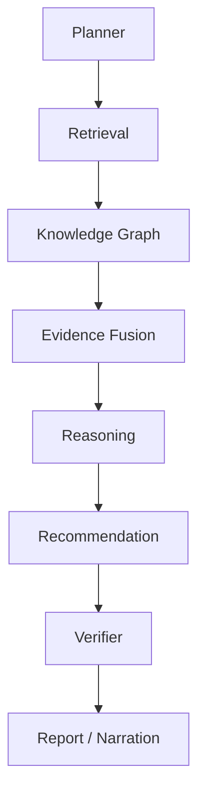

# Industrial Cognitive Engine (Reasoning)

The core claim of IKIOS: answers are *reasoned*, not retrieved-and-pasted.
Every chat query runs through an 8-stage LangGraph pipeline, each stage timed
and recorded into `state["latencies"]` for observability.

Implemented in [`app/orchestrator/graph.py`](../../backend/app/orchestrator/graph.py).
Verifier runs *after* Recommendation, not before — verification only makes
sense once there are recommendations to verify.

## 1. Planner

[`PlannerAgent`](../../backend/app/agents/planner.py) extracts entities from the
query and builds a **Task Graph**
([`TaskGraphPlanner`](../../backend/app/planning/planner.py)) — a small DAG of
sub-tasks (e.g. "look up P-101's incident history", "check compliance
requirements for P-101") rather than treating the query as one opaque
retrieval call. Never answers directly.

## 2. Retrieval

[`RetrievalAgent`](../../backend/app/agents/retrieval_agent.py) executes the
Task Graph via [`TaskGraphExecutor`](../../backend/app/planning/executor.py),
which calls the Hybrid Retriever per sub-task. See [retrieval.md](retrieval.md).

## 3. Knowledge Graph

[`KnowledgeGraphAgent`](../../backend/app/agents/knowledge_graph_agent.py) runs
`GraphExpansionStage` directly against the query, synthesizing evidence from
graph relations that chunk-level retrieval alone might miss.

## 4. Evidence Fusion

[`EvidenceFusionEngine`](../../backend/app/evidence/fusion.py) merges all
evidence gathered so far into a single deduplicated `EvidenceBundle`, and
[`EvidenceGraphBuilder`](../../backend/app/evidence/graph.py) builds a
**per-query temporary graph** connecting evidence items that share an entity
— the structure the next two stages reason over.

## 5. Reasoning

Two things happen here:

- [`ReasoningGraphBuilder`](../../backend/app/reasoning/reasoning_graph_builder.py)
  builds the **Industrial Reasoning Graph**: claims, supporting evidence, and
  inferred relationships between them.
- [`ContradictionDetector`](../../backend/app/contradiction/detector.py) scans
  the evidence bundle for conflicting statements about the same equipment tag
  (`\d{2,5}` pattern match) — e.g. two sources disagreeing on a valve's open/
  closed state — and emits a `Contradiction` with a severity
  (`low`/`medium`/`high`), a resolution strategy, and a suggested
  clarification question. **Contradictions are surfaced to the user, never
  silently resolved by picking one source.**

## 6. Recommendation

[`RecommendationEngine`](../../backend/app/recommendation/engine.py) proposes
concrete actions (inspect, replace, escalate) with priority, estimated
downtime/impact, required personnel/equipment/documents, and a confidence
score grounded in the supporting evidence — not generic advice.

## 7. Verifier

[`VerifierAgent`](../../backend/app/agents/verifier_agent.py) sanity-checks the
recommendations against the evidence bundle before narration — a final gate
against the reasoning stage having drawn an unsupported conclusion.

## 8. Report (Narration)

[`LLMNarrator`](../../backend/app/narration/narrator.py) produces the final
cited, human-readable answer. Runs in `mock` mode by default (deterministic,
offline, no API key) — set `LLM_PROVIDER=anthropic` for real generated
narration; every other stage is identical either way, since narration is the
only stage that touches an LLM.

## Why evidence fusion + a temporary per-query graph, not just "stuff it in the prompt"

Contradiction detection and reasoning-graph construction need *structure* —
which evidence items agree, which conflict, which share an entity — not just a
flat list of text snippets. Building that structure explicitly (rather than
hoping an LLM infers it from a long context window) is what makes
contradiction detection and recommendation justification deterministic and
testable, independent of the LLM provider in use.

## Observability

Every stage's latency is available in the `ChatResponse.latencies` field and
via `GET /api/v1/observability` — see [docs/api/README.md](../api/README.md).
