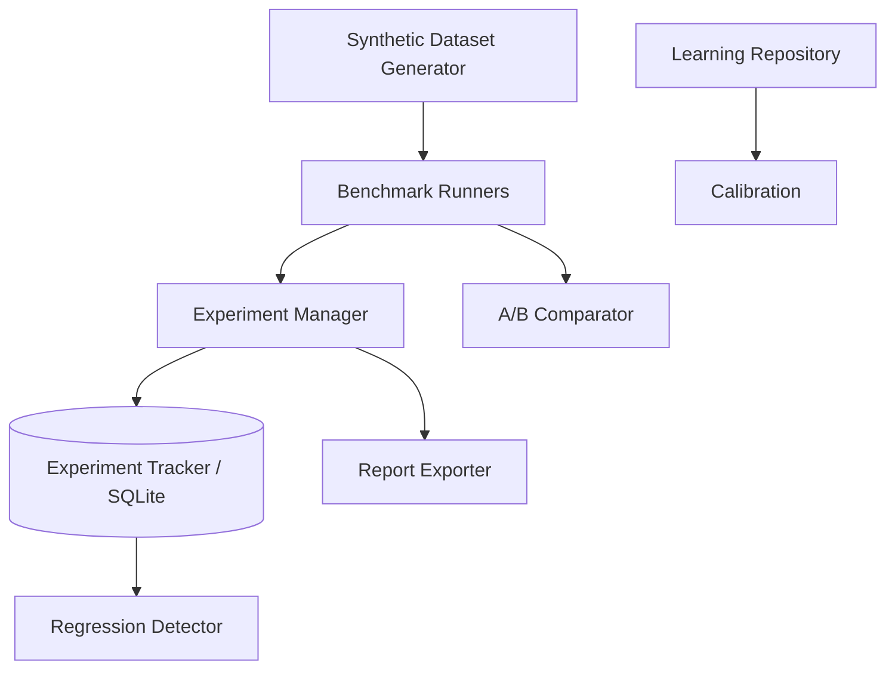

# Research Framework (M5)

A real experimentation platform, not a demo dashboard — every run is
reproducible, every metric is computed from actual execution, nothing is
canned.

## Experiment Manager

[`ExperimentManager`](../../backend/app/research/experiments/manager.py) wraps
every benchmark/training run in an `Experiment` record: configuration,
component versions (`ComponentVersion` — model/retriever/graph/reranker
versions, so you can answer "what exact code produced this number"),
git commit (auto-captured via `subprocess`), random seed, dataset, metrics,
duration, status. Persisted via
[`SqlExperimentTracker`](../../backend/app/research/experiments/repository.py).

## Benchmark Suite

8 async `BenchmarkRunner` implementations in
[`app/research/benchmarks/runners.py`](../../backend/app/research/benchmarks/runners.py):
Entity Extraction, Relation Extraction, Knowledge Graph, Hybrid Retrieval,
Reasoning, Recommendation, Prediction, Timeline — each measures the **real
production components** (the same `entity_extraction_service`,
`graph_repository`, etc. instances chat uses), not a parallel test-only
implementation.

## Synthetic Dataset Generator

[`SyntheticDatasetGenerator`](../../backend/app/research/datasets/generator.py)
produces deterministic (seeded), ground-truth-labeled documents — maintenance
logs, inspection reports, incident reports, SOPs, OEM manuals, failure
reports, permits, equipment histories — plus a
[`NoiseInjector`](../../backend/app/research/datasets/noise.py) that can add OCR
errors, typos, missing fields, duplicates, and conflicting statements, so
benchmarks can measure robustness, not just clean-data accuracy.

## A/B Testing

[`ABComparator`](../../backend/app/research/ab_testing/comparator.py) runs a
paired t-test (normal approximation via `math.erf`, no scipy dependency)
between two arms — e.g. regex-only vs. full production entity extraction —
and reports mean delta, t-statistic, p-value, and a winner.

## Reports

[`ReportExporter`](../../backend/app/research/reports/exporter.py) exports any
benchmark result to JSON, CSV, Markdown, or HTML.
[`RegressionDetector`](../../backend/app/research/reports/regression.py) compares
two experiment runs metric-by-metric, direction-aware (knows `latency` is
lower-is-better while `f1` is higher-is-better) — see
[docs/benchmarks/](../benchmarks) for real generated reports.

## Offline Evaluation Harness

[`OfflineEvaluationHarness`](../../backend/app/research/offline_evaluation/harness.py)
runs a benchmark while capturing memory (`tracemalloc`) and CPU time
(`time.process_time()`) — stdlib only, no external profiler dependency.

## Frontend

The **Research** workspace (`frontend/src/pages/ResearchPage.tsx`) runs
benchmarks and A/B tests on demand, and charts F1 trend, latency trend, A/B
comparison, confidence calibration, and experiment history — all via
Recharts, all from live API responses.
