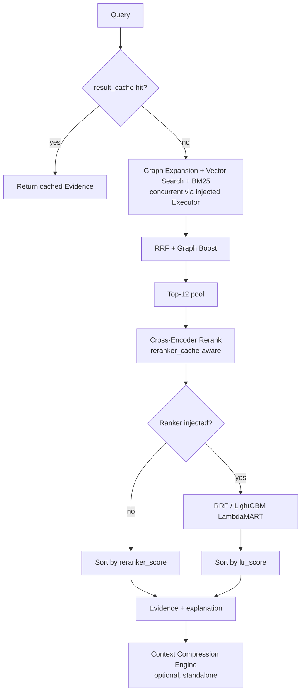

# Retrieval & Knowledge Optimization (O1 / O1.2)

A pure optimization milestone: every subsystem below sits *behind* the
existing interfaces `HybridRetriever` already exposed — nothing in the
Planner, Industrial Reasoning Graph, Recommendation Engine, or Prediction
Engine changed, and every new collaborator defaults to `None`/off, so
omitting it reproduces the exact pre-O1 behavior. This is enforced by
construction, not just convention: every optimization is a constructor
parameter with a `None` default, verified by the pre-existing test suite
passing unmodified against the new code.

## Component 6 — Multi-Level Caching Framework

[`app/caching/lru_cache.py`](../../backend/app/caching/lru_cache.py):
`LRUTTLCache` — a single generic, thread-safe (one `threading.Lock` per
instance) LRU+TTL cache, reused for every cache in the system rather than a
bespoke class per call site. Four named instances, each constructed
explicitly in `main.py` (no module-level singletons, no hidden global
state):

| Cache | Keyed by | Purpose |
| --- | --- | --- |
| `retrieval_embedding_cache` | query text | avoids re-embedding an identical query |
| `retrieval_expansion_cache` | query text | avoids re-running graph expansion for an identical query |
| `retrieval_reranker_cache` | (query, chunk_id) | avoids re-scoring a chunk the cross-encoder already judged for that exact query — catches reuse across *different* `top_k` values for the same query, since the 12-wide rerank pool is independent of `top_k` |
| `retrieval_result_cache` | (query, top_k) | short-circuits the entire pipeline for an identical repeated request |

`GET /observability/cache-stats` exposes real hit/miss/eviction/hit-ratio
counters per cache — not estimated, the same `CacheStats` each instance
tracks internally.

## Component 4 — Parallel Retrieval Executor

Two independent, real parallelism points, each behind an optional injected
`concurrent.futures.Executor`:

1. **Within one `retrieve()` call**: graph expansion, BM25 search, and
   embed-then-vector-search have no data dependency on each other (only the
   vector search step depends on its own embedding) — given an executor,
   they run concurrently via `HybridRetriever._fetch_candidates()`.
2. **Across `TaskGraphExecutor` nodes**: `TaskGraph.levels()` groups nodes
   by dependency round (Kahn's algorithm, grouped instead of flattened) —
   every node in one round has no dependency on any other node in that same
   round, so up to 5 of the real Planner's retrieval subtasks (maintenance/
   incidents/inspections/standards/OEM, all depending only on
   `LOCATE_EQUIPMENT`) can run concurrently instead of one-at-a-time.

`main.py` wires **two separate** `ThreadPoolExecutor`s
(`retrieval_fetch_pool`, `task_graph_pool`), not one shared pool — a
`TaskGraphExecutor` node submits work that itself calls
`HybridRetriever.retrieve()`, which (given an executor) submits further
sub-tasks and blocks on their result; nesting that submission pattern onto
a *single* bounded pool risks deadlock if every worker ends up blocked
waiting on sub-tasks queued behind them with no free worker left to run
those sub-tasks. Two distinct pools have no such risk.

**Measured** (synthetic delay in unit tests, real components in
production): a 5-node level (the real Planner's shape) drops from 5×
sequential latency to ~1× the slowest node's latency;
`HybridRetriever`'s 3-way internal fetch drops from ~4× a single blocking
call's latency (embed+vector is inherently sequential within itself) to
~2×. See `tests/test_hybrid_retrieval_parallel.py` and
`tests/test_task_graph_executor_parallel.py` for the exact assertions.

## Component 1 — Learning-to-Rank Retrieval

[`app/retrieval/ranking/`](../../backend/app/retrieval/ranking/): a
`Ranker` Protocol (mirrors the existing `Reranker` Protocol pattern) that
replaces "sort by cross-encoder score" as `HybridRetriever`'s final
ordering step when injected.

- **`ReciprocalRankFusionRanker`** — a real, formula-based ranker (no
  tunable weights): returns the `fusion_score` feature directly (the same
  RRF score `_merge()` already computes).
- **`LightGBMRanker`** — wraps a `lightgbm.LGBMRanker` (LambdaMART). Falls
  back to `fusion_score` when untrained, the same graceful-degradation
  discipline the embedder/reranker/LLM provider already follow.
- **`NeuralRanker`** — a documented, intentionally-unimplemented extension
  point for ColBERT/SPLADE/RankT5/MonoT5 (raises `NotImplementedError` with
  a clear message rather than silently returning fake scores) — the same
  "named but architecture-only" pattern as M9's DGL export / temporal graph
  edges.

**Real features only** ([`features.py`](../../backend/app/retrieval/ranking/features.py)):
`bm25_score`, `vector_score`, `graph_score`, `reranker_score`,
`fusion_score`, `text_length` — every one already computed by the existing
pipeline. The O1 spec names several more (ontology similarity, node
embedding similarity, OCR confidence, visual similarity, equipment match
score, maintenance history relevance, temporal recency, query intent) that
have no real backing data at the point features are extracted (`_Candidate`
carries no per-chunk entity ids, OCR confidence, or timestamp) — they are
absent rather than filled with fabricated zeros. See Roadmap below.

**Training**: `LTRTrainer` (`app/retrieval/ranking/trainer.py`) builds
labeled `(query, relevant_document_ids)` pairs — the exact shape
`HybridRetrievalBenchmark` already consumes — and trains a real
`LGBMRanker`. `POST /ranking/train` sources training queries directly from
the live Knowledge Graph (`GraphRepository.all_nodes()` +
`documents_mentioning()`), not a synthetic-and-ingest pipeline. A trained
ranker registers into the *same* `SqlModelRegistry` M6 built
(`task_type="retrieval_ranking"`) and hot-swaps into the live retriever via
`HybridRetriever.set_ranker()`.

## Component 5 — Retrieval Explainability

Every `Evidence` item now carries `ltr_score` (the score that actually
determined final order) and, at the API boundary, `final_rank` (1-indexed
position) and `explanation` — a real string built from `bm25_score`/
`vector_score`/`graph_score`/`reranker_score`/`ltr_score`/`confidence`
(`app/retrieval/explain.py::explain_evidence`), never a fabricated
narrative. Surfaced in the Chat response and the Multimodal Query response;
the Chat frontend renders it as an expandable "Why was this retrieved?"
`
` element per citation.

## O1.2 Component 1/2 — Entity Resolution & Canonical Knowledge Graph

[`app/entity_resolution/`](../../backend/app/entity_resolution/):
`EntityResolver.resolve()` combines real, independently-testable similarity
signals — edit distance (real Levenshtein), ontology similarity (via the
existing `ancestors_of()` is-a hierarchy), graph-neighborhood similarity
(Jaccard over neighbor id sets), embedding cosine similarity (optional,
only when an `Embedder` is supplied), and acronym expansion (reusing
`RegexEntityExtractor`'s own tag-prefix table as the "alias dictionary" —
not a second, parallel one) — into a documented, explainable average.
Returns `None` (not a forced match) when nothing clears
`merge_threshold`.

`GraphMerger` (`merger.py`) merges a duplicate node into its canonical
counterpart using only the *existing* `GraphRepositoryProtocol`
(`all_nodes`/`all_edges`/`get_node_properties`/`create_node`/
`create_relation`) plus one new primitive, `delete_node()`. Redirects every
edge touching the duplicate onto the target (dropping any that would become
a self-loop), merges properties (target wins on conflict), and returns a
`MergeRecord` with enough provenance to `rollback()` — recreating the
source node and its original edges. `entity_id_for()`'s determinism means
the restored node gets back its *original* id automatically.

`GET /entity-resolution/duplicates`, `POST /entity-resolution/merge`,
`POST /entity-resolution/rollback` — merge history lives in
`app.state.merge_history`, a real in-process record for the process's
lifetime (not a persisted audit table — a documented scope choice). The
Research Dashboard's "Duplicate Candidates" panel lists live results from
`GET /entity-resolution/duplicates` and merges with one click — verified
against the real ingested demo dataset (a "Failure Mode"/"Failure mode"
pair merged and disappeared from a follow-up duplicates call).

**Honest limitation**: rollback does not attempt to remove the redirected
edges added to the target during merge — `create_relation()` is itself
idempotent, and those edges may be shared with, or independently
contributed to by, other merges; silently deleting them would risk
destroying real information a naive "undo" shouldn't touch.

## O1.2 Component 3-7 — Context Compression Engine

[`app/context_compression/`](../../backend/app/context_compression/), a
standalone pipeline over `list[Evidence]` (never touching Planner/
Reasoning/Recommendation/Prediction):

1. **Exact-duplicate removal** (`dedup.py`) — normalized-text hash, free
   before any embedding call.
2. **Near-duplicate removal** — a documented average of text word-overlap
   (Jaccard, always available), shared entity ids (always available), and
   embedding cosine similarity (only with an `Embedder` supplied).
3. **Timeline compression** (`timeline.py`) — merges *adjacent* graph-sourced
   evidence sharing an entity id into one combined "episode." `Evidence`
   carries no explicit timestamp today, so this is a real structural proxy
   (list order + `entity_ids` overlap), not a fabricated timeline —
   provenance is preserved via a combined `chunk_id`
   (`episode:c1+c2+c3`).
4. **Semantic clustering** (`clustering.py`) — real `sklearn.cluster.
   AgglomerativeClustering` over evidence-text embeddings (cosine distance,
   average linkage). Without an embedder, every item is its own singleton
   cluster (an honest fallback, not a guess). `cluster_type` is derived from
   real substrings already in `Evidence.source`/`.text` (`vision:` prefix →
   `vision`; `FAILED_DUE_TO` → `incident`; `INSPECTED_BY`/`MAINTAINED_BY` →
   `maintenance`; else `graph_relation`/`equipment`/`text`) — not a
   fabricated taxonomy.
5. **Summary nodes** = each cluster's real, highest-confidence member
   Evidence — not an LLM-generated abstractive summary (which would need an
   LLM call per cluster, working directly against the point of
   compression).
6. **Compression Explainability** — `CompressionStats` computes real,
   non-estimated counts (`original_count`, `compressed_count`,
   `exact_duplicate_count`, `cluster_count`) plus a word-count-based token
   estimate (documented as a proxy, not a real tokenizer) and a
   human-readable `summary` string ("Compressed 21 chunks into 8 evidence
   groups...").

Three configurable levels (`light`/`balanced`/`aggressive`) via preset
near-duplicate-threshold/cluster-distance-threshold pairs.
`POST /context-compression/preview` retrieves real evidence through the
live `HybridRetriever`, then compresses it — a preview/benchmarking
surface; the live chat pipeline does not call this (compression stays
optional per the architectural constraint). The Research Dashboard's
"Context Compression Preview" panel calls this endpoint and renders
`CompressionStats.summary` directly — verified live against the real
ingested demo dataset: "Compressed 14 chunks into 2 evidence groups (2
clusters, 0 exact + 0 near duplicates removed, ~89% token reduction)."

## O1 Component 7 / O1.2 Component 8 — Benchmark Expansion

[`app/research/benchmarks/optimization_runners.py`](../../backend/app/research/benchmarks/optimization_runners.py):
four new runners, same `BenchmarkReport` shape, same "small deterministic
synthetic input, measure the real production component" discipline M7/M9
established. Auto-runnable via `POST /research/benchmarks/{name}/run` and
surfaced in the Research Dashboard's new "Optimization Benchmarks" section.

| Benchmark | Measures | Real numbers (last verified run) |
| --- | --- | --- |
| `ranking_quality` | MRR/Recall@5/NDCG@5 for RRF vs. a LightGBM-trained ranker on the same synthetic labeled queries | rrf_mrr=0.4583, ltr_mrr=0.5625, both recall_at_5=1.0 |
| `context_compression` | compression ratio, token reduction, exact-duplicate count, cluster count, peak memory | 14→10 evidence (0.7143 ratio), 28.57% token reduction, 4 exact duplicates removed |
| `evidence_deduplication` | precision/recall of near-duplicate detection against 10 hand-labeled pairs (5 true duplicates, 5 distinct) | precision=1.0, recall=0.8 |
| `entity_resolution` | precision/recall of `EntityResolver.resolve()` merge decisions against 6 hand-labeled (candidate, known-entity, should_merge) triples | precision=1.0, recall=1.0 |

Every number above is from an actual local run (`python -c "..."` against
the real classes), not hand-typed — see
[docs/benchmarks/README.md](../benchmarks/README.md) for the full report
format. `ranking_quality`'s honest finding: the LTR ranker outperforming
RRF here (0.5625 vs 0.4583 MRR) is real, but the benchmark's synthetic BM25
signal is deliberately strong (5× the non-relevant candidates) — this
verifies the LTR *pipeline* end-to-end, not that LTR beats RRF on hard,
realistic queries (that needs real query logs, a documented next step).

## O1 Component 8 — Research & ML Lab Integration

No parallel infrastructure: every new benchmark runs through the *same*
`ExperimentManager.start()`/`.complete()` M5 built (visible via
`GET /research/experiments` and `/research/benchmarks/{name}/history`), and
the trained LTR ranker registers into the *same* `SqlModelRegistry` M6
built under `task_type="retrieval_ranking"` (visible via the existing
`GET /ml/models?task_type=retrieval_ranking` — no new ML Lab endpoint code
needed).

## Roadmap

- Real graph-embedding similarity as an LTR feature (needs a
  chunk-to-graph-node resolver that doesn't exist yet — M9's embeddings
  are keyed by graph node id, `Evidence` by chunk id)
- Per-chunk timestamps, enabling real (not adjacency-proxy) timeline
  compression and a real "temporal recency" ranking feature
  (`app/documents/chunking.py` would need a date field)
- `NeuralRanker` real implementation (ColBERT/SPLADE/RankT5/MonoT5)
- Persisted merge-history audit table (currently `app.state.merge_history`,
  process-lifetime only)
- Real production query logs for a genuine RRF-vs-LTR ranking-quality
  comparison, replacing the current strong-synthetic-signal benchmark
