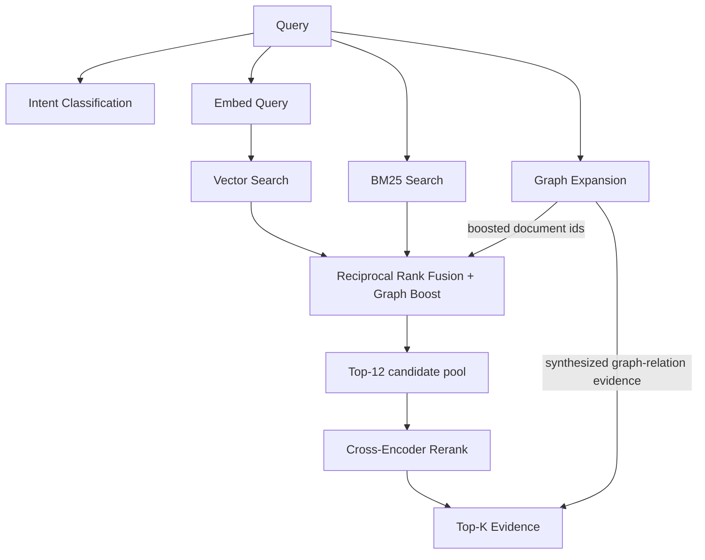

# Hybrid Retrieval

Never retrieves by embeddings alone. Every query runs through vector search,
BM25, and graph expansion simultaneously, fused, then cross-encoder reranked.

Implemented in [`HybridRetriever.retrieve()`](../../backend/app/retrieval/hybrid.py).

## Fusion math

**Reciprocal Rank Fusion**: each candidate's fusion score is
`sum(1 / (60 + rank + 1))` across whichever of {vector, BM25} ranked lists it
appears in — a candidate ranked highly by both methods scores higher than one
ranked highly by only one, without needing to normalize the two methods' raw
score scales against each other (RRF's whole point).

**Graph boost**: candidates whose `document_id` was flagged by
`GraphExpansionStage` as containing a graph-adjacent entity get a flat `+0.15`
added to fusion score — enough to matter in ranking without letting graph
membership alone override strong vector/BM25 agreement.

## Graph expansion

[`GraphExpansionStage`](../../backend/app/retrieval/graph_expansion.py) does two
things per query, not one:

1. Extracts entities from the query text, looks up their graph neighbors, and
   returns the **set of document ids** those neighbors were mentioned in — fed
   into the fusion boost above.
2. **Synthesizes evidence directly from graph relations** (e.g. a `Pump
   FAILED_DUE_TO Valve` edge becomes a standalone evidence item) and appends it
   to the final evidence list *after* reranking — so a documented relationship
   an LLM should reason about is never at the mercy of chunk-level retrieval
   even if no single chunk states it explicitly.

`MENTIONS` relations (document → entity bookkeeping edges) are explicitly
excluded from synthesized evidence — they're structural, not domain
knowledge, and including them was found to pollute reasoning with noise
during M3 verification.

## Reranking

A cross-encoder (`cross-encoder/ms-marco-MiniLM-L-6-v2` by default) scores the
top-12 fused candidates against the query directly (not just via embedding
similarity) before the final top-K cut. Falls back to a rank-preserving
passthrough if the model can't load — see [deployment.md](deployment.md).
Confidence per evidence item is `sigmoid(reranker_score)`.

## Evidence object

Every returned `Evidence` item carries `vector_score`, `bm25_score`,
`graph_score`, `reranker_score`, `confidence`, `source`, and provenance
(`document_id`, `chunk_id`, `page_number`) — the full retrieval trail is
visible to downstream reasoning and to the user via citations, not collapsed
into an opaque single score.

## Extension point: metadata filtering

`_metadata_filter()` is a documented no-op today — once ingestion captures
richer per-chunk metadata (document type, department, date), it plugs in here
to filter/boost candidates by query intent before fusion, without touching
anything else in the pipeline.
