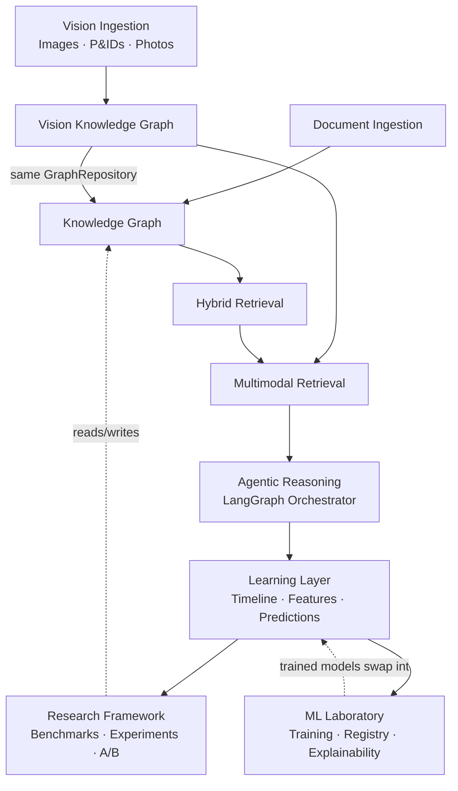
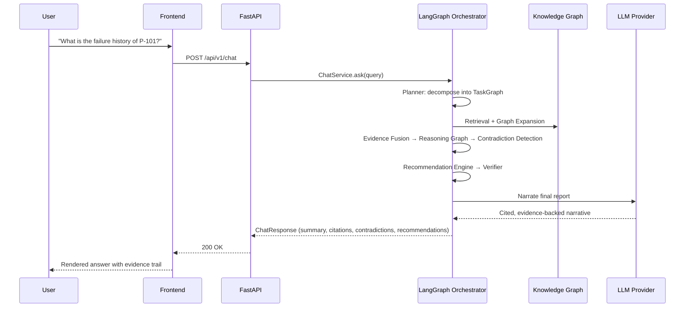
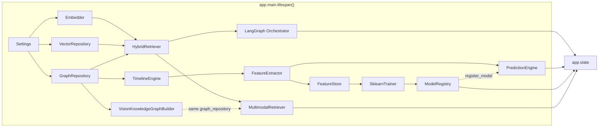

# System Overview

IKIOS is not a chatbot wrapped around vector search. It's a layered industrial
knowledge platform: every layer is independently replaceable, every heavy
dependency degrades gracefully, and every new capability (M4 Learning, M5
Research, M6 ML Lab) was added as an **independent subsystem** that never
modifies the chat orchestrator it sits alongside.

## The eight layers

Layers 5, 6, 7, and 8 (Learning, Research, ML Lab, Vision) are **additive**:
each exposes its own FastAPI routes and `app.state` services, and reuses the
same `entity_extraction_service`, `graph_repository`, and `retriever`
instances the chat pipeline uses — so benchmarks measure the real production
components, not a parallel implementation. None of them touch the
orchestrator in layer 4. Vision (M7) additionally proves this pattern scales
across modalities: its evidence reaches reasoning through the exact same
`Evidence` type and `GraphRepositoryProtocol` every other layer already uses
— see [vision.md](vision.md).

## Request flow (Chat)

See [reasoning.md](reasoning.md) for the 8-stage pipeline in detail.

## Composition root

Every dependency is constructed exactly once, in
[`backend/app/main.py`](../../backend/app/main.py)'s `lifespan()`, and stored on
`app.state`. No module reaches for a global — everything is passed in. This is
what makes every layer swappable: replace `build_graph_repository` and every
consumer (retrieval, timeline, feature extraction, ML feature store) gets the
new implementation for free.

## Design principles that hold across every milestone

1. **Never fabricate.** Missing data is `None`/optional, not a guessed default.
   See [`EquipmentFeatureVector`](../../backend/app/features/models.py).
2. **Graceful degradation.** Every optional heavy dependency (GLiNER, Qdrant,
   Neo4j, cross-encoder reranker) logs a `WARNING` and falls back to a working
   alternative rather than crashing. See [deployment.md](deployment.md).
3. **Protocol + implementation.** Every repository/service that might need a
   different backend later is defined as a `Protocol` with one or more
   concrete implementations (e.g. `GraphRepositoryProtocol` →
   `GraphRepository` (Neo4j) / `InMemoryGraphRepository`).
4. **Independent subsystems.** M4/M5/M6 each add new FastAPI routes and
   `app.state` services without editing the M3 orchestrator.
5. **No regressions, ever.** Every milestone's test suite is a strict superset
   of the previous one's — 440+ tests currently pass, zero have ever been
   deleted or weakened to make a later milestone easier.

## Where to go next

- [backend.md](backend.md) — service layer, repository pattern, dependency wiring
- [frontend.md](frontend.md) — React workspace structure
- [ingestion.md](ingestion.md) — document → chunks → embeddings → graph
- [knowledge-graph.md](knowledge-graph.md) — ontology, entities, relations
- [retrieval.md](retrieval.md) — BM25 + vector + graph fusion + reranking
- [reasoning.md](reasoning.md) — the 8-stage cognitive engine
- [learning-layer.md](learning-layer.md) — timeline, features, rule-based prediction
- [ml-lab.md](ml-lab.md) — real scikit-learn training, registry, explainability
- [vision.md](vision.md) — multimodal vision intelligence (M7): OCR, diagrams, gauges, defects
- [diagram-parser.md](diagram-parser.md) — engineering diagram symbol detection
- [multimodal-retrieval.md](multimodal-retrieval.md) — text + visual evidence fusion
- [research.md](research.md) — benchmarks, experiments, A/B testing
- [deployment.md](deployment.md) — fallback matrix, Docker, environments
