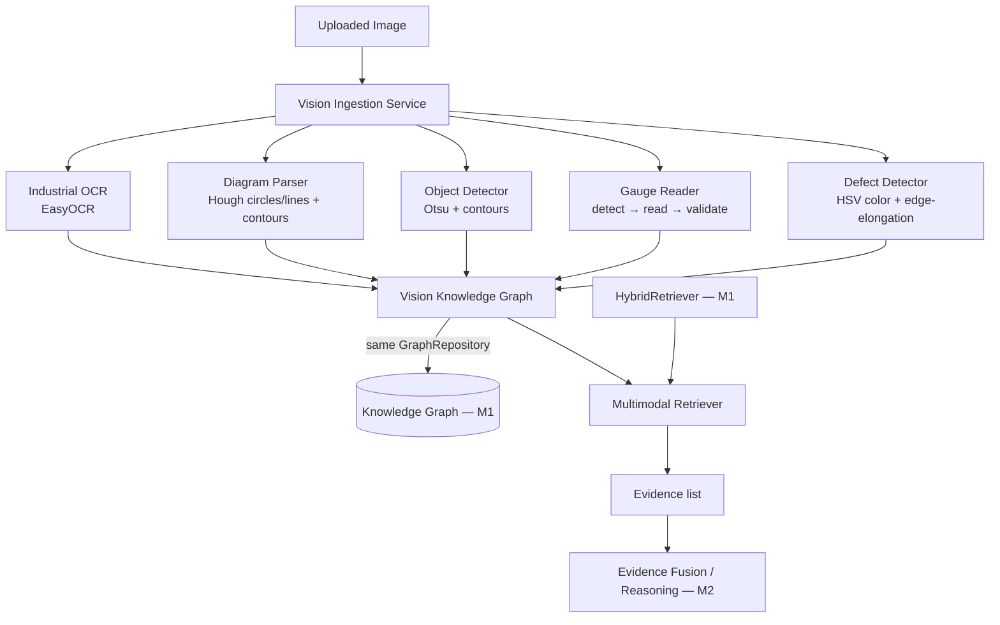

# Multimodal Vision Intelligence (M7)

IKIOS stops being document-centric here: images (inspection photos, equipment
photos, P&IDs, electrical schematics, engineering drawings) become first-class
documents alongside text, and every vision analysis result becomes ordinary
graph evidence — never a separate "image answer." All new code lives under
[`app/vision/`](../../backend/app/vision), its own independent subsystem
(own database, own API routes, zero changes to the M3 chat orchestrator).

## Design principle: reuse, don't parallel-build

Every vision output becomes:

1. A node in the **same** `GraphRepositoryProtocol` (Neo4j or in-memory) every
   other subsystem writes to — see [Vision Knowledge Graph](#vision-knowledge-graph) below.
2. An ordinary `Evidence` dataclass instance (`app/retrieval/evidence.py`) with
   `source="vision:{NodeType}"` — the exact same type `HybridRetriever`
   already produces. `EvidenceFusionEngine`, `ContradictionDetector`, and
   `ReasoningGraphBuilder` needed **zero code changes** to consume it. This is
   the concrete mechanism behind the M7 spec's "never bypass Evidence Fusion."

## 1. Vision Ingestion Framework

[`VisionIngestionService`](../../backend/app/vision/ingestion/service.py)
validates (Pillow `Image.open().verify()`), stores to disk
(`VISION_IMAGES_DIR`), and records metadata via
[`VisionMetadataRepository`](../../backend/app/vision/ingestion/repository.py)
(its own SQLite/Postgres table, `VISION_DB_URL`). Seven source types are
supported today (`VisionSourceType`): inspection photo, equipment photo, P&ID
diagram, electrical schematic, engineering drawing, maintenance image,
handwritten note. Thermal imaging, drone imagery, and CCTV snapshots are
documented future values, not silently unsupported — see
[docs/roadmap/README.md](../roadmap/README.md#vision).

No assumption is made about image source from pixels alone — the uploader
states `source_type` and an optional `equipment_hint`, the same "classifying
content from bytes is out of scope for a rule-based baseline" honesty applied
throughout M7.

## 2. Industrial OCR

[`EasyOCRProvider`](../../backend/app/vision/ocr/provider.py) wraps EasyOCR
(pure-Python, pip-installable, network-downloaded models — no system binary
like Tesseract). Each hit becomes a structured
[`OCRRegion`](../../backend/app/vision/ocr/models.py): text, confidence,
`BoundingBox`, source `image_id`. `UnavailableOCRProvider` is the fallback if
the model can't load (no network, disk quota) — returns `[]`, never crashes
ingestion, the same degrade-not-crash pattern GLiNER/the embedder/the
reranker already use. Handwriting is attempted (EasyOCR's recognition model
isn't typed-text-only) but with lower, honestly-expected accuracy — not a
documented non-goal, just a real limitation.

## 3. Engineering Diagram Understanding

See [diagram-parser.md](diagram-parser.md) for the full design and honest
precision/recall discussion.
[`ClassicalCVDiagramParser`](../../backend/app/vision/diagram/parser.py)
detects valves/instruments (Hough circles), equipment blocks (quadrilateral
contours), and pipes (Hough line segments) — classical CV, not a trained
symbol classifier, by explicit design choice.

## 4. Equipment Recognition

[`ClassicalCVObjectDetector`](../../backend/app/vision/detection/detector.py)
is a region-proposal baseline (Otsu threshold + external contours), not
multi-class equipment classification — it answers "where is the salient
object," not "what model of pump is this." The `ObjectDetector` Protocol is
the seam a real YOLO/GroundingDINO/RT-DETR/Detectron2 model would fill
without changing `VisionKnowledgeGraphBuilder` or the API layer.

## 5. Gauge & Instrument Reading

[`app/vision/gauge/reader.py`](../../backend/app/vision/gauge/reader.py)
deliberately separates **detect → read → validate → graph-map** into four
independent stages (mirroring `PredictionEngine.register_model()`'s
swap-in-one-stage precedent from M4/M6), so a future ML-based needle reader
can replace only `read_gauge()`. Reading assumes the standard 270° industrial
dial sweep (-135° to +135° from top) and produces `normalized_value` — an
honest 0.0-1.0 fraction of full scale, **not** a calibrated engineering unit
(no PSI/°C conversion is possible without a labeled min/max). Digital
displays are architecture-only (`GaugeType.DIGITAL_DISPLAY` exists, no reader
implements it yet — OCR on a segmented digit region is the documented path).

## 6. Defect Detection

[`app/vision/defect/detector.py`](../../backend/app/vision/defect/detector.py)
has **real detectors for 2 of 8** documented `DefectType` values:

| Defect | Technique | Status |
| --- | --- | --- |
| Corrosion / rust | HSV color-range threshold + contours | Implemented |
| Crack | Canny edges + aspect-ratio/length filter | Implemented |
| Oil leakage, damaged insulation, loose components, missing bolts, surface wear | — | Architecture-only (`DefectType` value + graph node type exist; no detector function) |

Stated plainly rather than faked with an unreliable heuristic dressed up as
real detection — the same honesty precedent M6 set for SHAP
("documented extension point, not implemented").

## Vision Knowledge Graph

Ontology additions in [`app/ontology/labels.py`](../../backend/app/ontology/labels.py):

**New `EntityLabel` values**: `IMAGE`, `DETECTED_OBJECT`, `BOUNDING_BOX`,
`DEFECT`, `DIAGRAM_SYMBOL`, `GAUGE_READING`, `OCR_REGION`, `VISUAL_EVIDENCE`
(an abstract hierarchy parent — see
[`app/ontology/hierarchy.py`](../../backend/app/ontology/hierarchy.py) — grouping
`DetectedObject`/`Defect`/`DiagramSymbol`/`GaugeReading`/`OCRRegion`, mirroring
how `MAINTENANCE_RECORD` already groups `Inspection`/`Incident`).

**New `RelationType` values**: `DEPICTS`, `DETECTED_IN`, `LOCATED_AT`,
`READ_FROM`, `ASSOCIATED_WITH`, `OBSERVED_DURING`, `SUPPORTS`, `CONTRADICTS`.

[`VisionKnowledgeGraphBuilder`](../../backend/app/vision/graph/builder.py) is the
image analog of `KnowledgeGraphBuilder` (M1): every OCR region, diagram
symbol, detection, gauge reading, and defect becomes a graph node written
through the exact same `GraphRepositoryProtocol`, linked back to its source
`Image` node and, where a matching domain entity exists, to that entity too
(`ASSOCIATED_WITH`/`DEPICTS`). Nothing here is an isolated, returned-only blob.

Instance-level vision nodes (a specific OCR hit, a specific detection) aren't
canonical named domain entities the way "Pump P-101" is, so each gets a fresh
UUID `canonical_name` — the same approach Document nodes already use.

## Multimodal Retrieval

See [multimodal-retrieval.md](multimodal-retrieval.md) for the full design.
[`MultimodalRetriever`](../../backend/app/vision/retrieval/multimodal.py) merges
`HybridRetriever`'s text evidence with visual evidence attached to the
query's resolved entities — into **one** evidence list. No separate image
answer, ever.

## Model Abstraction Guide

Seven reusable interfaces, all in [`app/vision/`](../../backend/app/vision) —
no model-specific code (EasyOCR, OpenCV) leaks outside its adapter:

| Interface | File | Concrete implementation today | Swap-in path |
| --- | --- | --- | --- |
| `VisionModel` | [`abstractions.py`](../../backend/app/vision/abstractions.py) | Every adapter below (structural `name`/`version`) | New adapter class |
| `OCRProvider` | [`ocr/provider.py`](../../backend/app/vision/ocr/provider.py) | `EasyOCRProvider` / `UnavailableOCRProvider` | New class implementing `extract_text()` |
| `DiagramParser` | [`diagram/parser.py`](../../backend/app/vision/diagram/parser.py) | `ClassicalCVDiagramParser` | Trained symbol classifier implementing `parse()` |
| `ObjectDetector` | [`detection/detector.py`](../../backend/app/vision/detection/detector.py) | `ClassicalCVObjectDetector` | YOLO/GroundingDINO/RT-DETR/Detectron2 implementing `detect()` |
| `DefectDetector` | [`defect/detector.py`](../../backend/app/vision/defect/detector.py) | `ClassicalCVDefectDetector` (2/8 types) | Object-detection/segmentation model implementing `detect()` |
| `GaugeReader` | [`gauge/reader.py`](../../backend/app/vision/gauge/reader.py) | Classical CV (`detect_gauges`/`read_gauge`/`validate_reading`) | Replace only `read_gauge()` with an ML regressor |
| `VisionFeatureExtractor` | [`abstractions.py`](../../backend/app/vision/abstractions.py) | **None — architecture-only** | Embedding model (CLIP/ResNet) for image-similarity search or a real defect classifier |

`VisionModel` is a common identity contract (`name: str`, `version: str`)
every concrete adapter above also satisfies, so the graph/benchmarks can
record which model configuration produced a given result — mirroring how
`SqlModelRegistry` (M6) already versions every trained model. It adds no new
behavior, just provenance.

## Research Integration (Component 10)

Seven new benchmark runners in
[`app/research/benchmarks/vision_runners.py`](../../backend/app/research/benchmarks/vision_runners.py) —
`OCRBenchmark`, `DiagramParsingBenchmark`, `EquipmentRecognitionBenchmark`,
`GaugeReadingBenchmark`, `DefectDetectionBenchmark`,
`MultimodalRetrievalBenchmark`, `VisionLatencyBenchmark` — all produce the
same `BenchmarkReport` shape and integrate with the existing
`ExperimentManager` via `POST /research/benchmarks/{name}/run`. No parallel
research framework: these are new runner classes in the same module family
as M5's `EntityExtractionBenchmark`/`KnowledgeGraphBenchmark`/etc., each
generating its own small deterministic synthetic images or graph (matching
`SyntheticDatasetGenerator`'s in-memory approach) rather than depending on
files on disk or polluting the live production graph.

## API

New router: [`app/api/v1/vision.py`](../../backend/app/api/v1/vision.py),
prefix `/vision`. See [docs/api/README.md](../api/README.md#vision-m7) for
the full endpoint list.

## Frontend (M7.1)

The **Vision Workspace** ([`frontend/src/pages/VisionPage.tsx`](../../frontend/src/pages/VisionPage.tsx))
is a single-page workspace covering the full analysis-to-reasoning workflow:
drag-and-drop upload → interactive SVG-overlay viewer (zoom, per-layer
toggles, hover tooltips, click-to-select) → analysis results → Knowledge
Graph panel → Multimodal Query → Research benchmarks, all synchronized
through one shared selection key so clicking a detection in any panel
highlights it everywhere else. See
[docs/architecture/frontend.md](frontend.md) and
[docs/showcase/README.md](../showcase/README.md#example-vision-workspace-session)
for a real, verified end-to-end session (not a mockup).

Two small, additive API endpoints were added while integrating the frontend
— exactly the "minor API fixes discovered during integration" this
milestone's spec allowed, not a backend redesign:

- **`GET /vision/images/{id}/file`** — serves the stored image bytes. Every
  other route returned metadata/analysis *about* an image; nothing served
  the image itself for the viewer's `` tag to render.
- **`graph_node_id`** on every `VisionAnalysisOut` result item (OCR region,
  detection, diagram symbol, gauge reading, defect) — populated by zipping
  the node ids `VisionKnowledgeGraphBuilder.add_*()` already returned into
  the API response, so the frontend can highlight the exact graph node a
  click corresponds to without a new graph-query endpoint.
- **`size_bytes`** on `VisionDocumentOut` — the upload panel's Component 2
  requirement ("filename, dimensions, size...") needed real data, not a
  fabricated display; `VisionIngestionService` already had the byte count
  in memory at ingest time.

**Scoping decisions, stated plainly:**

- **No virtualization library.** Large result lists cap at 50 visible items
  with a "Show N more" expand button rather than pulling in `react-window`
  for what are, at this platform's demo scale, small result sets — a
  pragmatic approximation, not full virtualization.
- **"Show progress" during analysis is a loading state, not a fake
  multi-step animation.** `POST /vision/images/{id}/analyze` runs OCR,
  diagram parsing, detection, gauge reading, and defect detection as one
  atomic synchronous call — the UI honestly reflects that (spinner, then a
  completed checklist all at once) rather than fabricating incremental
  progress the backend doesn't actually report.
- **"Highlight related entities" on Knowledge Graph selection** is scoped to
  what the current API surface actually supports: selecting a row
  highlights the same item in the image overlay and its category list.
  There's no backend endpoint for "find entities related to this one," so
  the frontend doesn't pretend to have one.

## Honest, measured limitations

- **Classical CV, not deep learning**: every detector here is explainable
  and deterministic, but genuinely less accurate on cluttered/composite
  scenes than an isolated single shape — see
  [`vision_demo_data/README.md`](../../vision_demo_data/README.md) for a real,
  reproduced example (a P&ID's pump rectangle isn't reliably found in a
  multi-shape composite scene, even though an isolated rectangle is).
- **Coarse diagram labels**: every detected circle is labeled `VALVE`, every
  quadrilateral `PUMP` — classical shape detection cannot distinguish a pump
  block from a generic equipment block, or a valve circle from a gauge dial,
  by shape alone. Confidence and bounding box are always preserved so a
  human (or a future model) can correct the coarse label.
- **`GaugeReading.normalized_value` is not a calibrated unit** — see
  Component 5 above.
- **6 of 8 defect types are architecture-only** — see Component 6 above.
- **`VisionFeatureExtractor` has no implementation** — architecture-only,
  see Model Abstraction Guide above.

## Where to go next

- [diagram-parser.md](diagram-parser.md) — full diagram parsing design
- [multimodal-retrieval.md](multimodal-retrieval.md) — full retrieval design
- [knowledge-graph.md](knowledge-graph.md) — the pre-existing text-side ontology
- [research.md](research.md) — the benchmark suite these vision runners extend
- [docs/roadmap/README.md](../roadmap/README.md#vision) — deep learning upgrade paths
