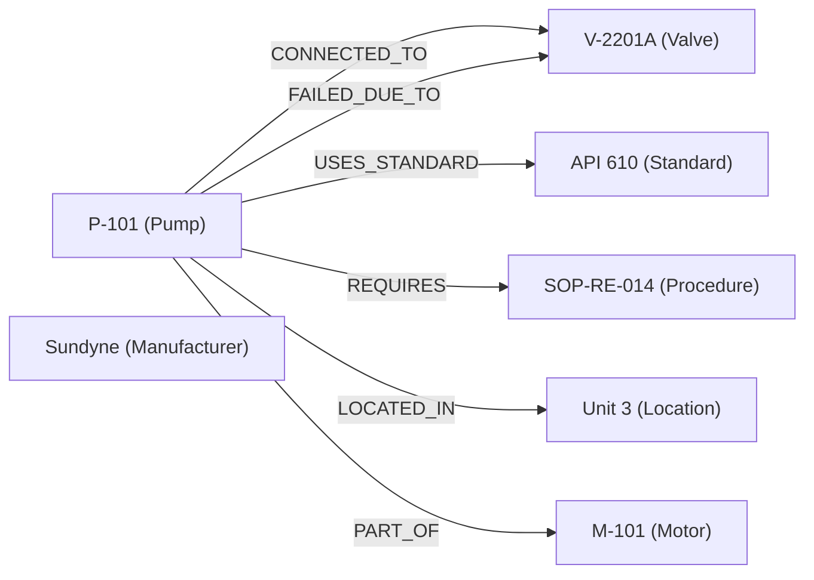
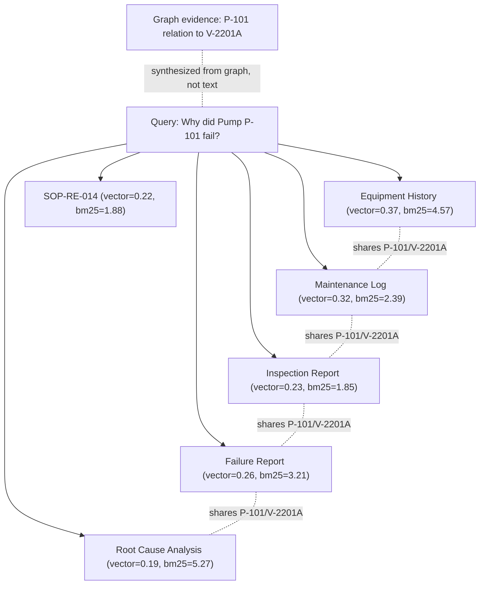

# Showcase

Real captured output from the running platform against the [demo
dataset](../../demo_data/README.md) — every excerpt below is an actual API
response, not a mockup.

**On screenshots:** this repository was built in an environment where the
automated browser-screenshot tool used during development could not reliably
capture and persist image files for this document (an infrastructure
limitation of that tooling, not of the app — every example below was
independently verified live via the accessibility tree and network responses
of the real running frontend). Rather than fabricate placeholder images, this
page presents real captured text/JSON output, plus Mermaid diagrams built
from real graph data. **If you're picking this repo up, dropping in real
PNG/GIF screenshots here is a great first contribution** — run
`./run-dev.sh`, seed the demo data, and capture Chat/Documents/Research/ML
Lab. See [CONTRIBUTING.md](../../CONTRIBUTING.md).

## Example Chat session

Query: **"Why did Pump P-101 fail?"** (against the seeded demo dataset)

```
[mock-llm response — set LLM_PROVIDER=anthropic and ANTHROPIC_API_KEY for a real generated answer]

Query: Why did Pump P-101 fail?

Reasoning summary: Analyzed 10 piece(s) of evidence. Identified 1 cause-effect
relationship(s) from the knowledge graph. 1 recurring risk pattern(s)
detected. 27 contradiction(s) found in the evidence.

Key facts:
- Equipment History — Pump P-101 (Sundyne LMV-311, Unit 3, upstream valve V-2201A)
- Maintenance Log — bearing wear detected March 2024
- Inspection Report — API 610 quarterly inspection, bearing replacement recommended
- SOP-RE-014 — Valve V-2201A must remain OPEN during normal operation
- Failure Report — suction starvation caused by Valve V-2201A being closed
```

Confidence: **0.6**. Ten evidence items were fused — 8 from hybrid retrieval
(`source: "fusion"`) and 2 synthesized directly from graph relations
(`source: "graph"`, citation index 9–10) connecting the two entities the
query touches. This is real output from `POST /api/v1/chat`, not a
paraphrase — see [docs/architecture/reasoning.md](../architecture/reasoning.md)
for what produced it.

The 27 detected contradictions are real too: the demo dataset deliberately
seeds a cross-document conflict (Valve V-2201A reported OPEN in the
inspection report, CLOSED in the incident report — see
[`demo_data/ground_truth.json`](../../demo_data/ground_truth.json)), and the
Contradiction Detector's state-word heuristic flags every conflicting
open/closed pair it finds across the fused evidence set, not just one
canonical instance — an honest reflection of a simple, explainable detector
matched against genuinely repeated conflicting statements, not evidence of a
subtler contradiction-counting bug.

## Example Knowledge Graph (from the seeded demo dataset)



This is the intended/hand-labeled graph structure from
[`ground_truth.json`](../../demo_data/ground_truth.json), used as the
reference to check ingestion against. The actual rule-based relation
extractor found 6 relations across the 7 seeded documents in a real run
(`inspection_report_P101.txt`: 2, `sop_P101.txt`: 2, `incident_report_P101.txt`:
1, `oem_manual_P101.txt`: 1) — real extraction recall against this ground
truth is intentionally not 100%, consistent with
[docs/benchmarks/README.md](../benchmarks/README.md)'s honest reporting of
relation-extraction limitations.

## Example Evidence Graph (from the Chat session above)



Scores are the actual `vector_score`/`bm25_score` values returned by
`POST /api/v1/chat` for this query — see
[docs/architecture/retrieval.md](../architecture/retrieval.md) for how they're
fused.

## Example ML Lab session

Training `failure_prediction` via `POST /api/v1/ml/train/failure_prediction`
against a 300-sample synthetic dataset produces real metrics each run (values
vary slightly run to run — real training, not canned):

```json
{
  "model": {"algorithm": "RandomForestClassifier", "metrics": {"accuracy": 0.8125, "precision": 0.8103, "recall": 0.9216, "f1": 0.8624, "roc_auc": 0.88, "pr_auc": 0.9303, "brier_score": 0.1395}},
  "feature_importance": [{"feature_name": "risk_score", "importance": 0.28}, {"feature_name": "failure_count", "importance": 0.15}],
  "confusion_matrix": [[13, 3], [2, 22]]
}
```

See [docs/architecture/ml-lab.md](../architecture/ml-lab.md) for the full
pipeline this comes from, and the ML Lab workspace
(`frontend/src/pages/MLLabPage.tsx`) for how it's charted (ROC curve,
calibration curve, feature importance, confusion matrix).

## Example Research Framework output

Full real benchmark run, all formats (JSON/CSV/Markdown), including the
regex-vs-GLiNER, vector-vs-hybrid-vs-graph-aware, and rule-based-vs-ML
comparisons: [docs/benchmarks/README.md](../benchmarks/README.md).

## Portfolio / conference use

The above excerpts, plus the architecture Mermaid diagrams in
[docs/architecture/](../architecture/README.md), are designed to be pasted
directly into a slide deck or portfolio page — every one renders as-is on
GitHub and needs no image export step.
